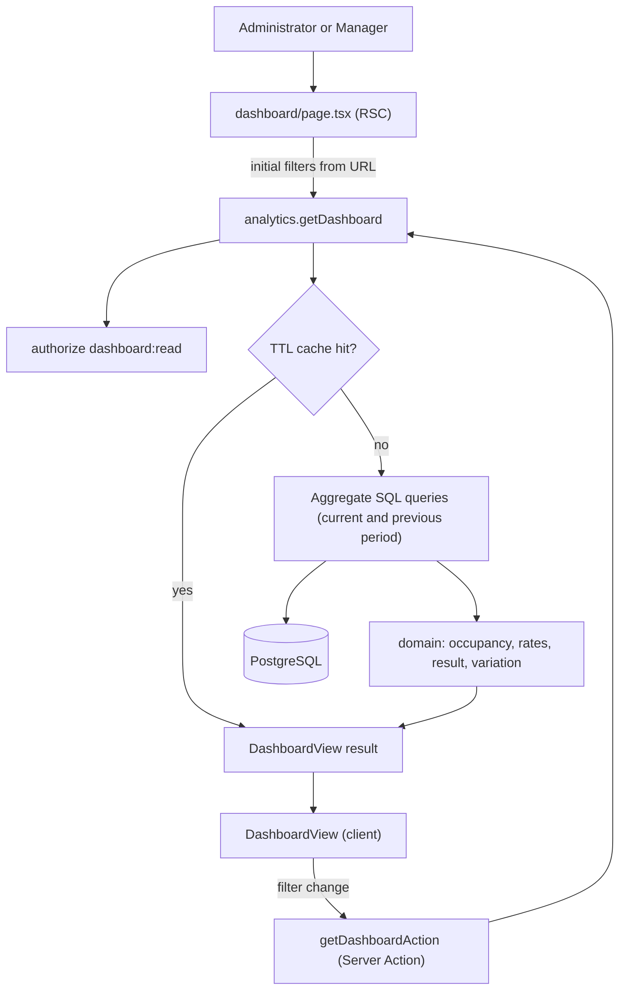

# Technical Specification: F12. Management Dashboard

**Complexity:** medium

## 1. Technical Overview

**What.** A new `analytics` module in the **read-only** tier (architecture section 3) and the screen at `/dashboard` that replaces the "under construction" placeholder. It covers:
- **Filters.**
  - Period: "Hoje", "Últimos 7 dias", "Últimos 30 dias", "Mês atual", "Mês anterior" and "Personalizado" (at most 366 days).
  - Unit: "Todas as unidades" or one unit.
  - Professional: "Todos os profissionais" or one professional.
  - Changing a filter recalculates every KPI. The filters are kept in the URL, so a reload or a shared link shows the same view.
- **Operação KPIs** (first row of cards):
  - "Agendamentos": appointments in the period, excluding cancelled ones.
  - "Concluídos": appointments with status `COMPLETED`.
  - "Taxa de ocupação": booked minutes ÷ available minutes (section 3).
  - "Taxa de cancelamento": cancelled ÷ all booked (cancelled included).
  - "Taxa de faltas": no-shows ÷ (completed + no-shows).
  - "Novos pacientes": patients registered in the period.
- **Financeiro KPIs** (second row of cards), each listed **one line per currency** and never summed across currencies (PRD F16):
  - "Faturado": net amount of non-cancelled charges created in the period.
  - "Recebido": payments minus refunds received in the period.
  - "A receber": open balance (net − paid) of non-cancelled charges created in the period.
  - "Ticket médio": received ÷ completed appointments, per currency.
  - "Despesas pagas": paid expenses plus manual cash withdrawals, without transfers or reversals.
  - "Resultado": received + manual revenues − paid expenses. It matches the result of the F11 statement for the same unit and period.
  - With a professional selected, "Despesas pagas" and "Resultado" are hidden, and a short note explains why.
- **Comparison with the previous period** (from Full Scope). Each card shows its change versus the previous equivalent period:
  - percentage for counts and money;
  - percentage points for rates.
- **Formula tooltips.** Each card has a tooltip with its formula, in the user's language.
- **Freshness.** The screen shows "Atualizado às 14:35". The results are cached in memory for up to 5 minutes per filter combination.
- **Empty state.** A period without data shows "Sem dados para o período selecionado." in place of the cards.

**Why.** The dashboard reads data owned by five modules (scheduling, professionals, patients, billing, cash), and it must load in 3 seconds or less (p95) for 30 days and all units, with about 15,000 appointments. That is why:
- **SQL aggregates, not ORM loops.** Counts and money totals are computed by aggregate SQL queries in the database (architecture section 8). Only occupancy needs per-row work. It loads the minimal rows (working intervals, closures, time-offs, appointment ranges) and computes them in a pure function, because local working hours have to be converted to instants in each unit's time zone (ADR-030).
- **The formulas are pure functions.** Occupancy, rates, ticket, result, the previous period and the variation are unit tested against the PRD formulas. The queries only feed them.
- **A short-lived cache.** The PRD accepts data up to 5 minutes old. The cache serves repeated loads and the previous-period figures without hitting the database again.

**How it fits the codebase.**
- **Patterns from earlier features:**
  - The use case follows `authorize`, then `parseInput`, then the queries inside `withTransaction` (read only).
  - It returns a `Result` with message keys from a catalog in three languages (ADR-028).
  - Raw SQL filters `organization_id` explicitly, as `patients/application/search.ts` does.
  - Money totals keep their currency (ADR-029). Calendar dates are taken in each unit's time zone (ADR-019).
  - The client view re-runs a Server Action on each filter change, like `cash/ui/statement-view.tsx`.
- **New in this feature:**
  - The `analytics` module.
  - A small in-process TTL cache.
  - One index migration.
  - ADR-037.
  - A dashboard section in the design system.

### Scope

**Included:**
- Core Scope: KPI cards and filters for period, unit and professional.
- From Full Scope: comparison with the previous equivalent period, on every KPI.
- Integrated from cross-cutting concerns:
  - authorization (`dashboard:read`, with denials audited by `authorize`);
  - tenancy;
  - per-currency money (F16);
  - unit time zones (ADR-019 and ADR-030);
  - three catalogs (pt-BR, en, es);
  - design system cards (section 5.6).

**Deferred (Full Scope, after F13):**
- Charts: daily received revenue, appointments by status per day, top 5 services by revenue, revenue per professional. They need a chart library, which is not in the codebase.
- Drill-down from a KPI to the F13 report or list with the same filters. F13 does not exist yet.

**Input contracts (Consumes):**
- **F05:** `patient.created_at`, for "Novos pacientes".
- **F06:** appointment rows read by `analytics`:
  - `appointment`: unit, professional, `starts_at`, `ends_at`, `status`, `currency`;
  - working hours (`professional_schedule`, `professional_working_interval`) and `professional_time_off` from F04;
  - `unit_closure` from F02 (decision D2).
- **F09:**
  - `charge`: unit, professional, `created_at`, `status`, `net_minor`, `paid_minor`, `currency`;
  - `payment`: `kind`, `amount_minor`, `currency`, `unit_id`, `received_at`, joined with the charge's professional.
- **F11:**
  - `financial_entry` and `financial_entry_payment`: paid expenses and revenues, with no reversal;
  - `cash_movement`: not reversed, category not of kind `TRANSFER`, joined with `cash_register.business_date` and `unit_id`.
- **Filter lists:** `units.listUnits` and `professionals.listProfessionals`, through their public APIs.

**Output contracts (Provides):**
- `analytics.getDashboard(ctx, input)` returns a `DashboardView` (section 5). Only the dashboard page uses it in V1. F13 may reuse the period resolution and the query helpers.

### Traceability to the PRD

| PRD block | Where in this spec |
|---|---|
| Consumes (F05, F06, F09, F11) | Scope (input contracts), section 6 (tables read) |
| Core Scope | Scope → Included; sections 4 and 5 |
| Full Scope additions | Comparison → Included; charts and drill-down → Deferred |
| Capabilities (access, filters, KPIs, formulas, performance) | Sections 1 and 3, section 5 (response fields) |
| Experience (filter bar, two rows of cards, empty state, "Atualizado às") | Section 4 (frontend) and design notes in section 3 |
| Section 9, F12 criteria | Section 7, acceptance tests |
| Section 9 cross-feature criteria (F05→F12, F06/F09/F11→F12, F16 per-currency totals) | Section 7, cross-feature integration tests |

## 2. Architecture Impact

### Affected components

| Component | Path | Change |
|---|---|---|
| Analytics module | `src/modules/analytics/` | New (read-only tier) |
| Dashboard route | `src/app/(app)/dashboard/` | Placeholder replaced; new Server Action |
| Composition root | `src/composition.ts` | Registers the `analytics` catalog |
| Prisma schema and migration | `prisma/schema.prisma`, `prisma/migrations/0015_analytics/` | Indexes only |
| PRD | `docs/prd.en.md`, `docs/prd.pt-BR.md` | F12 capabilities refined with decisions D2–D7 |
| Architecture docs | `docs/architecture.en.md`, `docs/architecture.pt-BR.md` | ADR-037 |
| Design system docs | `docs/design-system.en.md`, `docs/design-system.pt-BR.md` | Dashboard section 5.17 |

### Data flow



- `analytics` reads other modules' tables with read-only SQL and never writes to them (architecture section 3).
- The unit and professional lists for the filters come from the public APIs of `units` and `professionals`.

## 3. Technical Decisions

| Decision | Chosen Approach | Alternative Considered | Trade-off |
|---|---|---|---|
| D1. Scope (interview) | Core Scope plus the previous-period comparison | Core only; Core plus all of Full Scope | Charts and drill-down wait for F13 and a chart library |
| D2. Occupancy (interview) | Available = working intervals − time-offs − unit closures, converted per local date with `localMinuteToUtc` in the unit's zone. Booked = for each professional, the **union** of the ranges of non-cancelled appointments (Encaixes and no-shows included), intersected with the available ranges. The rate never exceeds 100% | Literal PRD formula (raw durations, closures not deducted) | Minutes booked outside working hours do not count |
| D3. "Resultado" (interview) | Same lines as the F11 statement: received + paid manual revenues + manual cash entries − paid expenses − manual cash withdrawals. Transfers and reversed lines are excluded | Financial entries only | The cash movements need one more query |
| D4. Professional filter (interview) | Charge-based KPIs filter by `charge.professional_id`, so package sales without a professional drop out. "Despesas pagas" and "Resultado" are hidden. Occupancy and appointments filter by `professional_id` | Show expenses without the filter | The financial row has four cards when a professional is selected |
| D5. Cache (interview) | An in-process TTL cache in `analytics/application/cache.ts` (5 minutes, at most 500 entries, oldest evicted first). Its key is the organization, unit, professional, `from` and `to`. Authorization always runs before the cache | Next.js Cache Components (`use cache` needs `cacheComponents`, which changes rendering for the whole app); `unstable_cache` (deprecated in Next 16); a Postgres cache table | Each web instance keeps its own cache. That is acceptable within the 5-minute freshness of the PRD |
| D6. Previous period (interview) | Same length and same stretch: "Hoje" → yesterday; "Últimos N dias" → the N days before; "Mês atual" (day 1 to today) → day 1 to the same day of the previous month, capped at its last day; "Mês anterior" → the whole month before it; "Personalizado" → the same number of days right before | "Mês atual" against the whole previous month | Comparing partial months needs a capping rule (31 → 30 or 28) |
| D7. Variation (interview) | Counts and money: relative % rounded to an integer, per currency. Rates: difference in percentage points, with one decimal. A previous value of 0 gives "Sem base de comparação"; both values 0 give "Sem variação". The arrow and the color show only when \|change\| ≥ 5% or ≥ 2 p.p. (named constants). The color follows the meaning of each KPI | Relative % for rates too | Two formats to explain in the tooltip |
| D8. Query strategy | One aggregate query per KPI group (appointments, charges, payments, entries and movements, new patients). The rows for occupancy come from two queries. Each query runs with an explicit `unit_id = ANY($unitIds)` and a UTC window widened to cover every unit's zone, then filters exactly with `(ts AT TIME ZONE unit.time_zone)::date BETWEEN from AND to` | Prisma `groupBy` | Raw SQL needs explicit `organization_id` filters and an `EXPLAIN ANALYZE` in the pull request |
| D9. Pure functions in a read-only module | `domain/` holds pure functions only (period, occupancy, KPI math, variation), with no entities or repositories | All logic in `application/` | A small exception to the "simple tier" shape, justified by unit-testable formulas (recorded in ADR-037) |

### Assumptions

Each item below is a default applied where the PRD is silent. The user can review and override them.

1. **Classifying a record into the period.**
   - Each record falls into the period by its local date in its unit's time zone (ADR-019):
     - appointments by `starts_at`;
     - charges by `created_at`;
     - payments by `received_at`;
     - entry payments by `paid_on`, which is already a date;
     - cash movements by the `business_date` of their register.
   - "Geral" financial entries (`unit_id` null) count only when unit = all.
2. **Resolving the preset dates.**
   - The presets use "today" in the selected unit's time zone. With all units selected, they use the organization's time zone.
   - "Personalizado" accepts future dates, so the user can see next week's agenda load. A future period simply has no financial data.
3. **New patients with a filter.**
   - With unit = all and professional = all, "Novos pacientes" counts the patients whose `created_at` falls in the period, in the organization's time zone. This is the F05↔F12 cross-feature criterion.
   - With a unit or professional selected, it counts only the patients created in the period whose **first** non-cancelled appointment (at any time) is in that unit or with that professional. Patients have no unit.
4. **Ticket médio per currency** = received in currency C ÷ completed appointments whose `appointment.currency` is C. With no completed appointments, the card shows "—".
5. **Rates.**
   - A rate with a zero denominator is `null` and is shown as "—".
   - Rates are shown with one decimal ("72,4%").
6. **"Faturado"** includes charges awaiting discount approval (`PENDING_APPROVAL`) at their current net amount. "A receber" counts the statuses `PENDING_APPROVAL`, `OPEN` and `PARTIALLY_PAID`.
7. **Refunds.**
   - "Recebido" subtracts the refund rows (`kind = REFUND`) by their own `received_at` and unit.
   - A refund in the period of a payment from an earlier period lowers the current period.
8. **When the dashboard is empty.**
   - The period counts as empty when:
     - it has no appointments at all, cancelled ones included;
     - no patient was created in it;
     - it has no money line in any financial KPI.
   - An empty period shows the empty state. The filters stay visible.
9. **Default filters.**
   - Without URL parameters, the filters are "Mês atual", "Todas as unidades" and "Todos os profissionais".
   - The unit and professional lists include inactive ones, marked "(inativa)" or "(inativo)", because past periods may hold their data.
10. **Meaning of each KPI** (D7):
    - higher is better: appointments, completed, occupancy, new patients, billed, received, ticket and result;
    - lower is better: cancellation rate, no-show rate and paid expenses;
    - neutral, with no color: "A receber".
11. **No audit event.** The dashboard does not mutate data and does not show clinical content, so reads are not audited. Denials are audited by `authorize`, as everywhere else.
12. **Recalculation.** Filters apply on change. No "Aplicar" button is needed, so the screen has no primary button. While it recalculates, the cards keep the previous values with the text "Atualizando…" (`aria-live="polite"`).

### Open points

- If measurements show the 3-second target at risk, ADR-037 allows materialized daily aggregates. This spec does not plan them.

## 4. Component Overview

### Frontend

| File Path | New/Modified | Purpose | Key Responsibilities |
|---|---|---|---|
| `src/app/(app)/dashboard/page.tsx` | Modified | Server page | Checks `dashboard:read` with `requirePermission`, parses the filters in `searchParams`, loads the units, the professionals and the first `DashboardView`, and renders the client view |
| `src/app/(app)/dashboard/actions.ts` | New | Server Action | `getDashboardAction(input)` calls `analytics.getDashboard` and maps the result with `toActionResult(..., "analytics")` |
| `src/modules/analytics/ui/dashboard-view.tsx` | New | Client view | Holds the filter state, syncs it with the URL (`router.replace`), calls the action, shows "Atualizado às HH:mm", "Atualizando…", the empty state and the error alert |
| `src/modules/analytics/ui/dashboard-filters.tsx` | New | Filter bar | Period select, a date range shown for "Personalizado", unit and professional selects, all labelled and keyboard-accessible |
| `src/modules/analytics/ui/kpi-card.tsx` | New | Indicator card | Design system 5.6 card: `column-label` label, a `figure` value (one line per currency for money), the variation in `meta` with an arrow and color only when significant, and a formula tooltip reachable by keyboard |
| `src/modules/analytics/ui/kpi-sections.tsx` | New | Card rows | The "Operação" and "Financeiro" rows (section headings), the note when a professional is selected, and a responsive grid of 2 to 6 columns |

### Backend

| File Path | New/Modified | Purpose | Key Responsibilities |
|---|---|---|---|
| `src/modules/analytics/index.ts` | New | Public API | `analytics.getDashboard`, `createAnalytics(adjust)` for tests (clock, cache), `analyticsCatalog`, exported types |
| `src/modules/analytics/domain/limits.ts` | New | Named constants | `MAX_DASHBOARD_DAYS = 366`, `DASHBOARD_CACHE_TTL_MS`, `DASHBOARD_CACHE_MAX_ENTRIES`, `SIGNIFICANT_CHANGE_PERCENT = 5`, `SIGNIFICANT_CHANGE_POINTS = 2`, each with a PRD reference |
| `src/modules/analytics/domain/period.ts` | New | Period math | `resolvePeriod(preset, today, custom?)`, `previousPeriod(range, preset)`, day counting, month capping |
| `src/modules/analytics/domain/occupancy.ts` | New | Occupancy | `computeOccupancy({ intervals, closures, timeOffs, appointments, units, from, to })` → `{ bookedMinutes, availableMinutes }`, using a union of ranges per professional and DST-correct conversion |
| `src/modules/analytics/domain/kpis.ts` | New | KPI math | Rates (`ratio`), ticket per currency, result per currency, `variation(current, previous, kind)` with significance and meaning |
| `src/modules/analytics/domain/errors.ts` | New | Domain errors | `AnalyticsErrors.periodTooLong`, `periodInvalid`, `unitInvalid`, `professionalInvalid` |
| `src/modules/analytics/application/schemas.ts` | New | Zod input | `dashboardFiltersSchema` (section 5) |
| `src/modules/analytics/application/get-dashboard.ts` | New | Use case | Authorize → parse → resolve units and zones → cache lookup → run the queries for the current and previous periods → build the view |
| `src/modules/analytics/application/cache.ts` | New | TTL cache | `get`/`set` with an injected clock, a maximum size and oldest-first eviction; `clear()` for tests |
| `src/modules/analytics/application/queries/appointments.ts` | New | SQL | Counts per status, plus the appointment ranges for occupancy |
| `src/modules/analytics/application/queries/availability.ts` | New | SQL | Schedules valid in the period with their intervals, time-offs overlapping the window, closures overlapping the period |
| `src/modules/analytics/application/queries/charges.ts` | New | SQL | Billed and receivable per currency; received (payments − refunds) per currency |
| `src/modules/analytics/application/queries/cash.ts` | New | SQL | Paid revenues and expenses (no reversal) and non-transfer cash movements, per currency |
| `src/modules/analytics/application/queries/patients.ts` | New | SQL | New patients, with the first-appointment rule when filtered |
| `src/modules/analytics/messages/{catalog.ts,pt-BR.json,en.json,es.json}` | New | Catalogs | Labels, formulas, notes, errors, presets, empty state |
| `src/composition.ts` | Modified | Composition root | `registerCatalog("analytics", analyticsCatalog)` |

### Database

| Migration File | Tables Affected | Operation | Notes |
|---|---|---|---|
| `prisma/migrations/0015_analytics/migration.sql` | `patient`, `charge` | CREATE INDEX | `ix_patient_org_created` on `(organization_id, created_at)`; `ix_charge_org_unit_created` on `(organization_id, unit_id, created_at)`. No new tables |

## 5. API Contracts

The dashboard has no Route Handler. The page and the Server Action call the use case directly, as the other screens do.

### Error codes

| Code | HTTP-equivalent | pt-BR message (catalog `analytics`) |
|---|---|---|
| `ANALYTICS_PERIOD_TOO_LONG` | 400 | O período deve ter no máximo 366 dias. |
| `ANALYTICS_PERIOD_INVALID` | 400 | A data final deve ser igual ou posterior à data inicial. |
| `ANALYTICS_UNIT_INVALID` | 400 | Unidade não encontrada. |
| `ANALYTICS_PROFESSIONAL_INVALID` | 400 | Profissional não encontrado. |
| `FORBIDDEN` (shared) | 403 | The shared forbidden message; the page renders `forbidden()` |

### Action: Get dashboard (`getDashboardAction`)

- **Authentication:** session; permission `dashboard:read` (Administrator, Manager).

**Request**

| Field | Type | Required | Validation | Description |
|---|---|---|---|---|
| `period` | enum | yes | `TODAY`, `LAST_7_DAYS`, `LAST_30_DAYS`, `CURRENT_MONTH`, `PREVIOUS_MONTH`, `CUSTOM` | Preset |
| `from` | `YYYY-MM-DD` | when `CUSTOM` | valid date | First day, inclusive |
| `to` | `YYYY-MM-DD` | when `CUSTOM` | ≥ `from`; span ≤ 366 days | Last day, inclusive |
| `unit` | `"ALL"` or uuid | yes | an existing unit of the organization | Unit filter |
| `professional` | `"ALL"` or uuid | yes | an existing professional of the organization | Professional filter |

```json
{ "period": "CUSTOM", "from": "2026-09-01", "to": "2026-09-30", "unit": "ALL", "professional": "ALL" }
```

**Response (`DashboardView`)**

| Field | Type | Description |
|---|---|---|
| `period` | `{ from, to }` | Resolved range |
| `previousPeriod` | `{ from, to }` | Comparison range (D6) |
| `computedAt` | ISO instant | Shown as "Atualizado às HH:mm" in the anchor time zone |
| `timeZone` | IANA zone | Anchor zone used for the presets and `computedAt` |
| `isEmpty` | boolean | Assumption 8 |
| `professionalSelected` | boolean | Hides "Despesas pagas" and "Resultado" |
| `operations.appointments`, `.completed`, `.newPatients` | `CountKpi` | `{ value, previous, change }` |
| `operations.occupancy`, `.cancellationRate`, `.noShowRate` | `RateKpi` | `{ numerator, denominator, value: number \| null, previous: number \| null, change }` (values are ratios 0–1) |
| `finance.billed`, `.received`, `.receivable`, `.averageTicket` | `MoneyKpi` | `{ lines: [{ currency, amountMinor, previousMinor, change }] }`, sorted by currency |
| `finance.paidExpenses`, `.result` | `MoneyKpi \| null` | `null` when a professional is selected |
| `change` | `Change` | `{ kind: "PERCENT" \| "POINTS" \| "NO_BASE" \| "NONE", value: number \| null, significant: boolean, tone: "GOOD" \| "BAD" \| "NEUTRAL" }` |

Money is serialized as a decimal string in minor units, because the action result crosses the client boundary and `BigInt` cannot be sent as JSON.

```json
{
  "period": { "from": "2026-09-01", "to": "2026-09-30" },
  "previousPeriod": { "from": "2026-08-02", "to": "2026-08-31" },
  "computedAt": "2026-10-10T17:35:12.000Z",
  "timeZone": "America/Sao_Paulo",
  "isEmpty": false,
  "professionalSelected": false,
  "operations": {
    "appointments": { "value": 412, "previous": 368, "change": { "kind": "PERCENT", "value": 12, "significant": true, "tone": "GOOD" } },
    "completed": { "value": 371, "previous": 330, "change": { "kind": "PERCENT", "value": 12, "significant": true, "tone": "GOOD" } },
    "occupancy": { "numerator": 18540, "denominator": 25600, "value": 0.7242, "previous": 0.6912, "change": { "kind": "POINTS", "value": 3.3, "significant": true, "tone": "GOOD" } },
    "cancellationRate": { "numerator": 31, "denominator": 443, "value": 0.07, "previous": 0.081, "change": { "kind": "POINTS", "value": -1.1, "significant": false, "tone": "GOOD" } },
    "noShowRate": { "numerator": 18, "denominator": 389, "value": 0.0463, "previous": 0.05, "change": { "kind": "POINTS", "value": -0.4, "significant": false, "tone": "GOOD" } },
    "newPatients": { "value": 46, "previous": 0, "change": { "kind": "NO_BASE", "value": null, "significant": false, "tone": "NEUTRAL" } }
  },
  "finance": {
    "billed": { "lines": [{ "currency": "BRL", "amountMinor": "6120000", "previousMinor": "5480000", "change": { "kind": "PERCENT", "value": 12, "significant": true, "tone": "GOOD" } }] },
    "received": { "lines": [{ "currency": "BRL", "amountMinor": "5730000", "previousMinor": "5200000", "change": { "kind": "PERCENT", "value": 10, "significant": true, "tone": "GOOD" } }] },
    "receivable": { "lines": [{ "currency": "BRL", "amountMinor": "390000", "previousMinor": "280000", "change": { "kind": "PERCENT", "value": 39, "significant": true, "tone": "NEUTRAL" } }] },
    "averageTicket": { "lines": [{ "currency": "BRL", "amountMinor": "15445", "previousMinor": "15758", "change": { "kind": "PERCENT", "value": -2, "significant": false, "tone": "BAD" } }] },
    "paidExpenses": { "lines": [{ "currency": "BRL", "amountMinor": "2100000", "previousMinor": "2050000", "change": { "kind": "PERCENT", "value": 2, "significant": false, "tone": "BAD" } }] },
    "result": { "lines": [{ "currency": "BRL", "amountMinor": "3810000", "previousMinor": "3300000", "change": { "kind": "PERCENT", "value": 15, "significant": true, "tone": "GOOD" } }] }
  }
}
```

### Public module API (Provides)

- `analytics.getDashboard(ctx: RequestContext, input: unknown): Promise<Result<DashboardView>>`
- `createAnalytics(adjust?)` returns the same API with replaceable `clock` and `cache`, for tests.
- `analyticsCatalog: Catalog`

## 6. Data Model

No new tables. `analytics` only reads.

### Tables read

| Table | Columns used | Index used |
|---|---|---|
| `appointment` | `organization_id`, `unit_id`, `professional_id`, `starts_at`, `ends_at`, `status`, `currency`, `patient_id` | `ix_appointment_org_unit_start`, `ix_appointment_org_professional_start`, `ix_appointment_org_patient_start` (first appointment) |
| `professional_schedule`, `professional_working_interval` | `professional_id`, `valid_from`, `valid_until`, `unit_id`, `weekday`, `start_minute`, `end_minute` | `ix_schedule_professional_period`, `ix_pwi_unit` |
| `professional_time_off` | `professional_id`, `starts_at`, `ends_at` | `ix_time_off_professional_period` |
| `unit_closure` | `unit_id`, `starts_on`, `ends_on` | `ix_closure_unit_period` |
| `unit` | `id`, `time_zone`, `currency` | primary key |
| `patient` | `organization_id`, `created_at` | **new** `ix_patient_org_created` |
| `charge` | `unit_id`, `professional_id`, `created_at`, `status`, `net_minor`, `paid_minor`, `currency` | **new** `ix_charge_org_unit_created` |
| `payment` | `kind`, `amount_minor`, `currency`, `unit_id`, `received_at`, `charge_id` | `ix_payment_unit_received` |
| `financial_entry`, `financial_entry_payment` | `kind`, `unit_id`, `currency`, `paid_on`, `amount_minor`, `reversed_at`, `deleted_at` | `ix_financial_payment_paid_on` |
| `cash_movement`, `cash_register`, `financial_category` | `direction`, `amount_minor`, `currency`, `reversed_at`, `category.kind`, `register.unit_id`, `register.business_date` | `uq_cash_register_unit_day`, `ix_cash_movement_register` |

### Migration excerpt (hand-written)

```sql
-- 0015_analytics: indexes for the F12 dashboard aggregates (spec F12, section 6).
CREATE INDEX ix_patient_org_created ON patient (organization_id, created_at);
CREATE INDEX ix_charge_org_unit_created ON charge (organization_id, unit_id, created_at);
```

Both indexes are also declared in `schema.prisma` (`@@index`), so `prisma migrate diff` stays clean.

### Query shape (illustrative, not final code)

- Every query receives `organization_id`, the array of unit ids resolved from the filter, an optional professional id, and a UTC window:
  - `windowStart` = the earliest `zonedTimeToUtc(from 00:00)` among the units;
  - `windowEnd` = the latest `zonedTimeToUtc(to + 1 day 00:00)` among the units.
- Each query filters the indexed timestamp by the window, then joins `unit` and keeps rows where `(ts AT TIME ZONE unit.time_zone)::date BETWEEN from AND to`.
- Money aggregates `GROUP BY currency` and return `sum(...)::bigint`.

## 7. Testing Strategy

### Test files

| File | Kind |
|---|---|
| `src/modules/analytics/domain/period.test.ts` | Vitest unit |
| `src/modules/analytics/domain/occupancy.test.ts` | Vitest unit |
| `src/modules/analytics/domain/kpis.test.ts` | Vitest unit |
| `src/modules/analytics/application/cache.test.ts` | Vitest unit |
| `tests/integration/analytics/support.ts` | Controlled dataset builder (units in two currencies and time zones, professionals, schedules, appointments in every status, charges, payments, refunds, entries, movements) |
| `tests/integration/analytics/dashboard.test.ts` | Integration (Testcontainers) |
| `tests/integration/analytics/performance.test.ts` | Integration (seeded load) |
| `tests/e2e/f12-management-dashboard.spec.ts` | Playwright |

### Unit tests

- **Period resolution:**
  - `F12: presets resolve to the right range in the anchor time zone` (Hoje, 7, 30, current month, previous month).
  - `F12: previous period of the current month is capped at the last day of the previous month` (Mar 31 → Feb 28).
  - `F12: previous period of a custom range has the same length right before it`.
- **Occupancy:**
  - `F12: occupancy is booked minutes over working hours minus time-offs and unit closures`.
  - `F12: overlapping appointments of one professional are counted once and occupancy never exceeds 100%`.
  - `F12: minutes booked outside working hours do not count`.
  - `F12: working hours on a DST change day use the real length of the local interval`, using a zone with DST (ADR-030).
  - `F12: occupancy is null when no minutes are available`.
- **KPI math:**
  - `F12: cancellation rate is cancelled over all booked; no-show rate is no-shows over completed plus no-shows`.
  - `F12: average ticket and result are computed per currency and never summed across currencies`.
  - `F12: variation is a percentage for values and percentage points for rates`.
  - `F12: a zero previous value gives no comparison base`.
  - `F12: variation is significant from 5% or 2 p.p., and its tone follows the meaning of the KPI`.
- **Cache:**
  - `F12: cached results expire after 5 minutes`.
  - `F12: the cache evicts the oldest entry beyond its size`.

### Acceptance tests (PRD Section 9, F12)

| Criterion | Test (in `dashboard.test.ts` unless noted) |
|---|---|
| Only Administrator and Manager can access the dashboard | `F12: front desk and professional are denied the dashboard and the denial is audited`; E2E `F12: front desk cannot open the dashboard` |
| KPIs match the formulas for a controlled dataset | `F12: KPIs match the formulas for a controlled dataset` (occupancy, cancellation, no-shows, billed, received, receivables, average ticket, result, each asserted against hand-computed values) |
| Filters change all KPIs consistently; "Resultado" hidden with a professional | `F12: unit filter restricts every KPI to the unit`; `F12: professional filter restricts every KPI and hides paid expenses and result` |
| ≤ 3 s p95 for 30 days, all units, ~15,000 appointments | `F12: dashboard computes 30 days of all units with 15,000 appointments within 3 seconds at p95` (`performance.test.ts`: 20 uncached runs) |
| Empty period shows the message | `F12: an empty period is reported as empty`; E2E checks the text "Sem dados para o período selecionado." |
| Comparison shows the correct variation | `F12: comparison with the previous period shows the correct variation` |

### Other integration tests

- **Validation:**
  - `F12: a custom period longer than 366 days is rejected`.
  - `F12: a period ending before it starts is rejected`.
  - `F12: an unknown unit or professional is rejected`.
- **Tenancy:** `F12: data of another organization never appears in the dashboard`.
- **Time zones:** `F12: records are assigned to the period by their unit's local date`. A payment at 23:30 in Manaus belongs to that local day.
- **Cache:** `F12: a second load within 5 minutes returns the cached computedAt`.
- **Refunds:** `F12: refunds reduce received in the period of the refund`.
- **Transfers and reversals:** `F12: transfers and reversed movements are excluded from the result`.

### Cross-Feature Integration

| PRD criterion | Test |
|---|---|
| New patient counts match patients created in F05 | `F12: new patients match the patients created in F05 in the period` |
| KPIs match the totals from F06, F09 and F11 for the same filters | `F12: KPIs match the totals from appointments, charges and payments, and expenses`; `F12: result matches the F11 statement result for the same unit and period` (calls `cash.getStatement`) |
| F16 per-currency totals in F12 | `F12: money KPIs are listed per currency and never summed across currencies` (BRL and EUR units) |

### E2E journeys

1. `F12: manager opens the dashboard, changes the period and the unit, and sees the KPIs, the variation and "Atualizado às"`.
2. `F12: selecting a professional hides "Despesas pagas" and "Resultado"`.
3. `F12: front desk cannot open the dashboard`.
