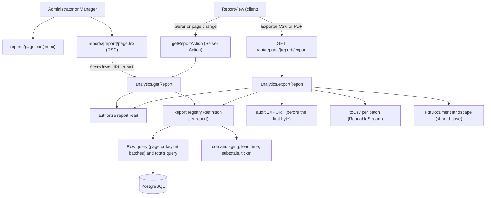

# Technical Specification: F13. Reports and Export

**Complexity:** medium

## 1. Technical Overview

**What.** Five read-only reports in the existing `analytics` module (read-only tier, ADR-037), a new `/reports` area, and the CSV and PDF exports. It covers:
- **Reports index** at `/reports`: a list of the five reports, each with its name and a one-line description, linking to `/reports/<report>`.
- **Five reports**, each with its own filters, a "Gerar" button (the one primary button of the screen), a result table paginated at 50 rows with a totals row, and the buttons "Exportar CSV" and "Exportar PDF":
  1. **Agendamentos** (`appointments`): date, time, patient, service, professional, unit, room, status, price.
  2. **Cancelamentos e faltas** (`cancellations`): date, patient, phone, service, professional, type, origin, reason, lead time in hours, plus a summary by reason and by professional.
  3. **Receitas** (`revenue`): payments and refunds of the period, with subtotals by the grouping the user picks (method, service, professional or unit).
  4. **Contas a receber** (`receivables`): open charges with patient, phone, origin, amount, open balance, days open and the aging bucket (0–30, 31–60, 61–90, 90+), plus a summary per bucket.
  5. **Produtividade por profissional** (`productivity`): per professional, completed, no-shows, cancellations, hours attended, billed, received and the average ticket.
- **Filters**: period (the F12 presets plus "Personalizado", at most 366 days), unit, professional, and the filters specific to each report (section 5). Filters are kept in the URL after "Gerar" and remembered per user and report in `sessionStorage` for the session.
- **CSV export** (Core): UTF-8 with BOM, separators of the user's language, a currency column for money, at most 50,000 rows, streamed in ≤ 10 seconds for 50,000 rows.
- **PDF export** (Full Scope): A4 landscape on the shared PDF base (ADR-024), with the organization logo and trade name, the report name, the applied filters, the summary totals, the table, and a footer with the generation date and user and "Página x de y". At most 5,000 rows. Above that, the user is told to export CSV.
- **Audit**: every export records an `EXPORT` event with the report, the format, the filters and the row count.

**Why.** Reports read data owned by scheduling, billing, patients, services, professionals and units. They return detail rows (not only aggregates), and they must export up to 50,000 rows quickly without loading them all in memory. That is why:
- **The same SQL feeds the screen, the CSV and the PDF.** Each report is one definition (columns, filters, row query, totals query) in a small registry. The screen reads one page with `LIMIT/OFFSET`. The exports read keyset batches and stream them. Totals always come from one aggregate query, so the screen, the CSV and the PDF agree with each other.
- **Streaming, not buffering.** The CSV Route Handler returns a `ReadableStream` that writes each batch as it arrives (architecture section 8). Memory stays bounded by the batch size.
- **Pure functions where there are rules.** The aging buckets, the lead time, the subtotals per grouping and the per-currency ticket are pure functions with unit tests. The queries only feed them.

**How it fits the codebase.**
- **Reused as is:**
  - `report:read` (Administrator, Manager) is already in the permission matrix.
  - `src/shared/i18n/csv.ts` (`toCsv`, `csvAmount`, formula-injection guard), written for F13 during F16.
  - The F12 period presets (`resolvePeriod`), the `QueryScope` with its UTC window and local-date filter (ADR-037), and the `analytics.validation.*` and `ANALYTICS_PERIOD_*` messages.
  - The shared PDF base (`PdfDocument`, `PdfTable`, `renderPdf`), the organization profile and logo (as the F06 agenda PDF reads them), and the download Route Handler pattern of `/api/schedule/agenda-pdf`.
  - Audit with `action: "EXPORT"` and `metadata`, as the agenda PDF does.
- **New in this feature:**
  - The report registry and the five report definitions inside `analytics`.
  - The `/reports` pages, one Server Action and one export Route Handler.
  - A `orientation` prop on `PdfDocument` and a `PdfSummary` block in the shared PDF base.
  - A "Relatórios" sidebar item.
  - ADR-038 and design system section 5.18.
- **No migration.** The existing indexes cover every query (section 6). `EXPLAIN ANALYZE` of each row query goes in the pull request.

### Scope

**Included:**
- Core Scope: the five reports with filters, the paginated table with totals, and CSV export.
- Full Scope: PDF export with the organization header, summary totals and page numbering.
- Integrated from cross-cutting concerns:
  - authorization (`report:read` on every use case and on the export endpoint, with denials audited by `authorize`);
  - tenancy (explicit `organization_id` in raw SQL);
  - audit of every export (architecture 5.3);
  - per-currency money, never summed across currencies (ADR-029, PRD F16);
  - unit time zones for the period and the dates shown (ADR-019, ADR-030);
  - three catalogs (pt-BR, en, es) for the screens, the CSV headers and values, and the PDF (ADR-028);
  - the design system tables, totals row and stamps (sections 5.4 and 5.5).

**Deferred:**
- The F12 drill-down from a KPI to a report. It belongs to F12 Full Scope. F13 makes it possible: every report reads its filters from the URL (output contracts below).
- Background generation of exports through pg-boss. The limits of the PRD fit a streamed request (decision D5).

**Input contracts (Consumes):**
- **F01:** organization profile (`tradeName`, falling back to `legalName`) and logo, through `getOrganizationProfile` and `identity.getOrganizationLogo`. The generating user's name comes from the `RequestContext`.
- **F06:** `appointment` (`unit_id`, `professional_id`, `service_id`, `patient_id`, `room_id`, `starts_at`, `duration_minutes`, `status`, `price_minor`, `currency`, `cancellation_origin`, `cancellation_reason_id`, `cancelled_at`), `cancellation_reason` (`name`).
- **F09:** `charge` (`origin`, `patient_id`, `service_id`, `professional_id`, `unit_id`, `net_minor`, `paid_minor`, `status`, `currency`, `created_at`, `number`), `payment` (`kind`, `method`, `amount_minor`, `currency`, `unit_id`, `received_at`, `charge_id`).
- **Lookups joined in SQL:** `patient` (display name with the social name first, mobile phone), `service`, `professional`, `unit` (`name`, `time_zone`, `country`), `room`.
- **Filter lists:** `units.listUnits`, `professionals.listProfessionals`, `services.listServices`, `scheduling.listCancellationReasons` (all including inactive records) and the payment methods of the units' country profiles.

**Output contracts (Provides):**
- `analytics.getReport(ctx, report, input)` → `ReportView` (section 5), used by the report pages.
- `analytics.exportReport(ctx, report, format, input)` → a CSV stream or PDF bytes, used by the export Route Handler.
- **URL contract** `/reports/<report>?period=…&from=…&to=…&unit=…&professional=…&<report filters>&run=1`. With `run=1`, the page generates on load. F12 can use it for the drill-down later.

### Traceability to the PRD

| PRD block | Where in this spec |
|---|---|
| Consumes (F01, F06, F09) | Scope (input contracts), section 6 (tables read) |
| Core Scope | Scope → Included; sections 4 and 5 |
| Full Scope additions (PDF) | Scope → Included; decision D6; section 5 (export) |
| Capabilities (access, 5 reports, 366 days, 50 rows, CSV, PDF, ≤ 10 s, audit) | Sections 1, 3 and 5 |
| Experience (index, "Gerar", export buttons, remembered filters, progress) | Section 4 (frontend), decisions D3, D7, D8 |
| Section 9, F13 criteria | Section 7, acceptance tests |
| Section 9 cross-feature criteria (F01→F13 header, F06/F09→F13 totals, F16 language and per-currency totals) | Section 7, cross-feature integration tests |

## 2. Architecture Impact

### Affected components

| Component | Path | Change |
|---|---|---|
| Analytics module | `src/modules/analytics/` | Report registry, five reports, three use cases, catalogs |
| Reports routes | `src/app/(app)/reports/` | New index and report pages, one Server Action |
| Export endpoint | `src/app/api/reports/[report]/export/route.ts` | New Route Handler (CSV stream or PDF) |
| Shared PDF base | `src/shared/pdf/document.tsx` | `orientation` prop and `PdfSummary` block |
| Sidebar | `src/shared/ui/app-shell/navigation.ts` and the shell catalogs | "Relatórios" item and icon |
| PRD | `docs/prd.en.md`, `docs/prd.pt-BR.md` | F13 refined with decisions D2, D3 and the assumptions |
| Architecture docs | `docs/architecture.en.md`, `docs/architecture.pt-BR.md` | ADR-038; F13 rows in sections 3 and 8 |
| Design system docs | `docs/design-system.en.md`, `docs/design-system.pt-BR.md` | Section 5.18 Reports |

### Data flow



- `analytics` reads other modules' tables with read-only SQL and never writes to them (architecture section 3). The only write is the audit event.
- The organization profile and logo come from the public API of `identity`. The filter lists come from the public APIs of `units`, `professionals`, `services` and `scheduling`.

## 3. Technical Decisions

Decision D1 was answered in the interview. The user then asked to apply the recommendation for every other decision, so D2–D13 are recommendations accepted by the user and may be reviewed.

| Decision | Chosen Approach | Alternative Considered | Trade-off |
|---|---|---|---|
| D1. Scope (interview) | Core Scope plus the Full Scope PDF | Core only | The shared PDF base needs a landscape option and a summary block |
| D2. Aging reference date (interview) | Charges have no due date and are due on issue (F09). Days open = today in the unit's zone − the local date of `charge.created_at`. Buckets: 0–30, 31–60, 61–90, 90+ (named constants). The column is "Dias em aberto", and its tooltip states the rule | Add `due_date` to `charge` (changes F09); appointment date for appointment charges | "Overdue" means "open since issue". Recorded in PRD F13 |
| D3. Reports index | A list (design system 5.4): name in `body-strong` as the link and a `meta` description. No card grid | Five cards, as the PRD Experience wording says | Cards are reserved for dashboard indicators (design system 5.6). PRD F13 Experience is reworded to "list" in both languages |
| D4. One definition per report | A registry `REPORTS: Record<ReportId, ReportDefinition>`. Each definition holds its Zod filter schema, columns (key, alignment, kind), `countAndTotals`, `page(offset, 50)`, `batches(after, size)` (keyset), and optional `summaries`. Screen, CSV and PDF format rows from the same typed row | One use case per report and format (15 use cases) | A generic shape that each report must fit |
| D5. CSV generation | A Route Handler streams a `ReadableStream`. Rows are read in keyset batches of 2,000 (`ORDER BY` the report's sort key plus `id`) and written with `toCsv` per batch, with the BOM only in the first chunk. The count runs first: above 50,000 the request fails with `ANALYTICS_EXPORT_TOO_LARGE` before any byte. The audit event is committed before the first byte | A `pg` cursor (no dependency for it today; Prisma raw queries cannot hold one); a pg-boss job with a stored file | Keyset batches keep memory bounded like a cursor, but each batch is its own query. Rows inserted during the export may appear, which is acceptable for a report |
| D6. PDF generation | Rendered on demand with the shared base: `PdfDocument` gains `orientation: "portrait" \| "landscape"` (default portrait) and the base gains `PdfSummary` (label and value pairs and small tables). The count runs first: above 5,000 rows the request fails with `ANALYTICS_PDF_TOO_LARGE`, whose message advises exporting CSV. The export button is disabled with the same advice when the last generated result already shows more than 5,000 rows | A separate PDF layout for reports | The other documents keep portrait without changes |
| D7. Download and progress | The client calls the export endpoint with `fetch`. For CSV, the response carries `X-Report-Rows`. The client counts the line breaks it receives and shows "Gerando arquivo… 12.000 de 48.000 linhas" (`aria-live="polite"`). For PDF it shows "Gerando PDF…". When done, it saves the blob through an object URL with the server's file name. Errors come back as JSON `{ code, messageKey }` and are shown in an alert | A plain link (no progress and no error message) | A small client helper for downloads |
| D8. Filter memory | The filters are read from the URL first. Without URL parameters, they come from `sessionStorage` under `gcli:reports:<userId>:<report>`, written on each "Gerar". Without either, the report defaults apply (assumption 3). "Gerar" writes the filters to the URL with `run=1` (`router.replace`) | Server-side preferences | Memory lasts for the browser session only, as the PRD asks |
| D9. Screen pagination | Offset pagination of 50 rows (architecture section 8, user-facing tables). The totals row and the summaries come from the aggregate query, never from the page | Keyset pagination on screen | Deep pages are slower. At most 50,000 rows ≈ 1,000 pages, acceptable |
| D10. Money per currency | Totals and subtotals are lists of `{ currency, amountMinor }` and are never summed across currencies. Productivity has one row per professional **and currency** (the currency of the appointments and charges), so counts and money stay consistent and summable per currency | One row per professional with several money lines | A professional who works in units with two currencies appears in two rows |
| D11. Period classification | As in F12 (ADR-037): appointments by the local date of `starts_at` (cancellations and no-shows included); payments by `received_at`; charges by `created_at`; all in their unit's zone, after a UTC window narrows the scan. The F12 helpers `utcWindow` and the unit and zone loading move to `analytics/application/queries/scope.ts` and are shared | Cancellations by `cancelled_at` | The cancellation report matches the F12 cancellation rate for the same filters |
| D12. No cache | Reports run on demand without the F12 TTL cache | Reusing the cache | A repeated "Gerar" hits the database. Freshness is immediate |
| D13. Export endpoint shape | One `GET /api/reports/[report]/export?format=csv\|pdf&<filters>` | Two handlers or a Server Action | A GET with a side effect (the audit event), as the agenda PDF already does. Same-origin cookies only, `Cache-Control: private, no-store` |

### Assumptions

Each item below is a default applied where the PRD is silent. The user can review and override them.

1. **Patient name and phone.** The patient column shows the display name (social name first, cross-feature rule F05). The phone is the mobile phone formatted for the unit's country, with the landline as fallback.
2. **Dates shown.** Dates and times are in the unit's time zone and the user's language format (`formatLocale(locale, unit.country)`). In the CSV, the date and the time are separate columns, formatted the way the user's language writes them, so Excel reads them as dates.
3. **Default filters.** "Mês atual", "Todas as unidades", "Todos os profissionais" and "Todos" for the other filters. "Contas a receber" defaults to "Personalizado" covering the last 366 days up to today, because open charges are older than the current month.
4. **"Contas a receber" filters.** The period filters the charge's issue date. The report lists charges that are open today: status `PENDING_APPROVAL`, `OPEN` or `PARTIALLY_PAID`, with balance = `net_minor − paid_minor` > 0. Extra filters: origin (Atendimento, Pacote, Avulsa) and aging bucket. Sort: days open descending.
5. **"Agendamentos".** The status filter is "Todos" or one status. Cancelled appointments appear when the filter includes them. The totals row shows the row count and the sum of the listed prices per currency. Sort: `starts_at`, then `id`.
6. **"Cancelamentos e faltas".**
   - Rows are appointments with status `CANCELLED` or `NO_SHOW`. Type filter: Todos, Cancelamentos, Faltas. Origin filter: Paciente, Clínica, Profissional (cancellations only).
   - Lead time = whole hours from `cancelled_at` to `starts_at`, rounded down. A cancellation after the start shows a negative number. No-shows show "—" for origin, reason and lead time.
   - The note typed with a cancellation is not exported, because it is free text that may hold personal data. The reason is the configured reason name.
   - Summaries: count per reason (cancellations only, plus "Sem motivo"), and per professional the cancellations and no-shows. Sort: `starts_at`, then `id`.
7. **"Receitas".**
   - Rows are payments (positive) and refunds (negative) received in the period. Columns: date, patient, charge number, method, service, professional, unit, type (Pagamento or Estorno), amount, currency.
   - The service and professional come from the charge. A package charge shows "Pacote de sessões" as the service, and a charge without a professional shows "Sem profissional".
   - Grouping: Forma de pagamento (default), Serviço, Profissional, Unidade. The subtotals table lists, per group and currency, payments, refunds and net. Rows are sorted by group, then `received_at`, then `id`.
   - Extra filters: payment method and service. The professional filter uses the charge's professional, as in F12.
8. **"Produtividade por profissional".**
   - One row per professional and currency (decision D10), including professionals with only cancellations.
   - Completed, no-shows and cancellations count appointments by `starts_at`. Hours attended = the sum of `duration_minutes` of completed appointments ÷ 60, with one decimal.
   - Billed = net of non-cancelled charges created in the period with that professional. Received = payments − refunds received in the period, of charges with that professional. Ticket = received ÷ completed, or "—" when nothing was completed. The same functions as F12 are reused.
   - Sort: professional name.
9. **On-screen views are not audited.** Only exports are audited (PRD F13). The screen shows no clinical content, and denials are audited by `authorize`, as everywhere else.
10. **File names.** `<report-slug>-<from>-<to>.csv|pdf` with the slug in the user's language (for example `agendamentos-2026-09-01-2026-09-30.csv`), without personal data.
11. **PDF filters text.** The subtitle lists the period and every filter that is not "Todos", by name (for example "Período: 01/09/2026 a 30/09/2026 · Unidade: Centro · Status: Faltou").
12. **Inactive records.** The filter lists include inactive units, professionals, services and reasons, marked "(inativo)" or "(inativa)", because past periods hold their data.

### Open points

- If the 10-second target is at risk with 50,000 rows, the batch size can change (named constant) before any other design change.

## 4. Component Overview

### Frontend

| File Path | New/Modified | Purpose | Key Responsibilities |
|---|---|---|---|
| `src/app/(app)/reports/page.tsx` | New | Reports index | Checks `report:read` with `requirePermission`, renders the list of the five reports (D3) |
| `src/app/(app)/reports/[report]/page.tsx` | New | Report page | Checks `report:read`, validates the `report` slug (`notFound()` otherwise), loads the filter lists, runs `getReport` when the URL has `run=1`, renders `ReportView` |
| `src/app/(app)/reports/actions.ts` | New | Server Action | `getReportAction(report, input)` calls `analytics.getReport` and maps the result with `toActionResult(..., "analytics")` |
| `src/modules/analytics/ui/reports-index.tsx` | New | Index list | The list of reports with name link and description |
| `src/modules/analytics/ui/report-view.tsx` | New | Client view | Holds the filters, restores them from the URL or `sessionStorage` (D8), runs "Gerar" and page changes, renders the summaries, the table, the pagination, the export buttons and the alerts |
| `src/modules/analytics/ui/report-filters.tsx` | New | Filter bar | Period with "Personalizado" dates, unit, professional, and the report's own filters, from the report's filter descriptors; all labelled and keyboard accessible |
| `src/modules/analytics/ui/report-table.tsx` | New | Result table | Columns from the definition (alignment, tabular numbers, status stamps), money per currency, totals row with the double rule (design system 5.4), the empty state |
| `src/modules/analytics/ui/report-summaries.tsx` | New | Summaries | Small tables above the result: by reason and by professional, aging buckets, revenue subtotals per group |
| `src/modules/analytics/ui/export-buttons.tsx` | New | Exports | "Exportar CSV" and "Exportar PDF" (secondary), progress text, download through an object URL, the PDF limit advice (D6, D7) |
| `src/modules/analytics/ui/download.ts` | New | Client helper | Fetches a URL, reports streamed line progress, saves the blob with the `Content-Disposition` name, parses error JSON |
| `src/shared/ui/app-shell/navigation.ts` | Modified | Sidebar | "Relatórios" item in the "Operação" group after "Dashboard", `anyOf: ["report:read"]`, new icon `report` |

### Backend

| File Path | New/Modified | Purpose | Key Responsibilities |
|---|---|---|---|
| `src/modules/analytics/index.ts` | Modified | Public API | Adds `getReport`, `exportReport`, `REPORT_IDS`, report types |
| `src/modules/analytics/domain/limits.ts` | Modified | Named constants | `MAX_REPORT_DAYS = 366`, `REPORT_PAGE_SIZE = 50`, `CSV_MAX_ROWS = 50_000`, `PDF_MAX_ROWS = 5_000`, `EXPORT_BATCH_SIZE = 2_000`, `AGING_BUCKETS` (0–30, 31–60, 61–90, 90+), each with a PRD reference |
| `src/modules/analytics/domain/aging.ts` | New | Aging | `daysOpen(issueDate, today)`, `agingBucket(days)` |
| `src/modules/analytics/domain/lead-time.ts` | New | Lead time | `leadTimeHours(cancelledAt, startsAt)` (whole hours, rounded down, may be negative) |
| `src/modules/analytics/domain/subtotals.ts` | New | Grouping | `subtotalsByGroup(rows, key)` → per group and currency: payments, refunds, net |
| `src/modules/analytics/domain/errors.ts` | Modified | Domain errors | Adds `reportNotFound`, `exportTooLarge`, `pdfTooLarge`, `serviceInvalid`, `reasonInvalid` |
| `src/modules/analytics/application/reports/registry.ts` | New | Registry | `REPORT_IDS`, `ReportDefinition` type, `REPORTS` map, slug lookup |
| `src/modules/analytics/application/reports/appointments.ts` | New | Report 1 | Filters schema, columns, count and totals, page, batches |
| `src/modules/analytics/application/reports/cancellations.ts` | New | Report 2 | Same, plus the summaries by reason and by professional |
| `src/modules/analytics/application/reports/revenue.ts` | New | Report 3 | Same, plus the grouping and the subtotals per group |
| `src/modules/analytics/application/reports/receivables.ts` | New | Report 4 | Same, plus the aging bucket filter and the summary per bucket |
| `src/modules/analytics/application/reports/productivity.ts` | New | Report 5 | One aggregate query per professional and currency (appointments, charges, payments joined in SQL); totals per currency |
| `src/modules/analytics/application/reports/schemas.ts` | New | Zod input | The common filter base (period, from, to, unit, professional) extended per report; messages are `analytics.validation.*` keys |
| `src/modules/analytics/application/reports/format.ts` | New | Row formatting | Turns a typed row into screen cells, CSV cells (`csvAmount`, dates per language) and PDF strings; translates statuses, origins, methods, types |
| `src/modules/analytics/application/get-report.ts` | New | Use case | Authorize `report:read` → resolve the definition → parse → resolve units, zones and period (≤ 366 days) → count and totals, page, summaries → `ReportView` |
| `src/modules/analytics/application/export-report.ts` | New | Use case | Authorize → parse → count against the format limit → record the `EXPORT` audit event → CSV: return the row count and a stream of batches; PDF: load the organization header, render, return the bytes |
| `src/modules/analytics/application/ports.ts` | New | Ports | `OrganizationHeader` (name and logo) and the PDF renderer, injected for tests |
| `src/modules/analytics/infrastructure/organization-header.ts` | New | Adapter | Reads the profile and logo through `identity`, as `scheduling/infrastructure/directory.ts` does |
| `src/modules/analytics/infrastructure/report-pdf.tsx` | New | PDF document | `PdfDocument` in landscape, the filters subtitle, `PdfSummary`, `PdfTable` with the report's column widths |
| `src/modules/analytics/application/queries/scope.ts` | Modified | Shared helpers | Receives `utcWindow` and the unit and zone loading from `get-dashboard.ts` (D11) |
| `src/modules/analytics/application/get-dashboard.ts` | Modified | Use case | Imports the moved helpers; no behavior change |
| `src/modules/analytics/messages/{pt-BR,en,es}.json` | Modified | Catalogs | `analytics.reports.*`: names, descriptions, columns, filters, groupings, types, origins, buckets, summaries, totals, progress texts, PDF texts, file slugs, errors |
| `src/app/api/reports/[report]/export/route.ts` | New | Route Handler | Builds the context, calls `analytics.exportReport`, returns the CSV stream (`text/csv; charset=utf-8`, `X-Report-Rows`) or the PDF (`application/pdf`), or `{ code, messageKey }` with the error's HTTP status (401 without a session, 403 forbidden) |
| `src/shared/pdf/document.tsx` | Modified | Shared PDF base | `orientation` prop (default portrait); `PdfSummary` block |
| `src/shared/i18n/messages/{pt-BR,en,es}.json` (shell catalog) | Modified | Catalogs | `shell.navigation.reports` in three languages |

### Database

No migration. Section 6 lists the indexes each query uses.

## 5. API Contracts

The report pages use a Server Action. The exports use a Route Handler, because the response is a file stream.

### Error codes

| Code | HTTP | pt-BR message (catalog `analytics`) |
|---|---|---|
| `ANALYTICS_PERIOD_TOO_LONG` (existing) | 400 | O período deve ter no máximo 366 dias. |
| `ANALYTICS_PERIOD_INVALID` (existing) | 400 | A data final deve ser igual ou posterior à data inicial. |
| `ANALYTICS_UNIT_INVALID` (existing) | 400 | Unidade não encontrada. |
| `ANALYTICS_PROFESSIONAL_INVALID` (existing) | 400 | Profissional não encontrado. |
| `ANALYTICS_SERVICE_INVALID` | 400 | Serviço não encontrado. |
| `ANALYTICS_REASON_INVALID` | 400 | Motivo de cancelamento não encontrado. |
| `ANALYTICS_REPORT_NOT_FOUND` | 404 | Relatório não encontrado. |
| `ANALYTICS_EXPORT_TOO_LARGE` | 422 | O resultado tem {count} linhas. A exportação em CSV aceita até 50.000 linhas. Reduza o período ou aplique mais filtros. |
| `ANALYTICS_PDF_TOO_LARGE` | 422 | O resultado tem {count} linhas. O PDF aceita até 5.000 linhas. Exporte em CSV ou aplique mais filtros. |
| `VALIDATION_ERROR` (shared) | 400 | Field messages from `analytics.validation.*` |
| `FORBIDDEN` (shared) | 403 | The shared forbidden message; pages render `forbidden()` |

### Common filters

| Field | Type | Required | Validation | Description |
|---|---|---|---|---|
| `period` | enum | yes | `TODAY`, `LAST_7_DAYS`, `LAST_30_DAYS`, `CURRENT_MONTH`, `PREVIOUS_MONTH`, `CUSTOM` | Preset, as F12 |
| `from`, `to` | `YYYY-MM-DD` | when `CUSTOM` | `to ≥ from`; span ≤ 366 days | Inclusive range |
| `unit` | `"ALL"` or uuid | yes (default `ALL`) | a unit of the organization | Unit filter |
| `professional` | `"ALL"` or uuid | yes (default `ALL`) | a professional of the organization | Professional filter |
| `page` | integer | no (default 1) | ≥ 1 | Screen page; ignored by exports |

### Report-specific filters

| Report | Field | Values |
|---|---|---|
| `appointments` | `service` | `ALL` or service uuid |
| `appointments` | `status` | `ALL`, `SCHEDULED`, `CONFIRMED`, `CHECKED_IN`, `IN_PROGRESS`, `COMPLETED`, `NO_SHOW`, `CANCELLED` |
| `cancellations` | `service` | `ALL` or service uuid |
| `cancellations` | `type` | `ALL`, `CANCELLED`, `NO_SHOW` |
| `cancellations` | `origin` | `ALL`, `PATIENT`, `CLINIC`, `PROFESSIONAL` |
| `cancellations` | `reason` | `ALL` or cancellation reason uuid |
| `revenue` | `groupBy` | `METHOD` (default), `SERVICE`, `PROFESSIONAL`, `UNIT` |
| `revenue` | `method` | `ALL` or a payment method code |
| `revenue` | `service` | `ALL` or service uuid |
| `receivables` | `origin` | `ALL`, `APPOINTMENT`, `PACKAGE`, `MANUAL` |
| `receivables` | `bucket` | `ALL`, `D0_30`, `D31_60`, `D61_90`, `D90_PLUS` |
| `productivity` | — | Common filters only |

### Action: Get report (`getReportAction`)

- **Authentication:** session; permission `report:read` (Administrator, Manager).
- **Input:** `report` (one of `appointments`, `cancellations`, `revenue`, `receivables`, `productivity`) and the filters above.

```json
{
  "report": "cancellations",
  "filters": { "period": "CUSTOM", "from": "2026-09-01", "to": "2026-09-30", "unit": "ALL", "professional": "ALL", "type": "ALL", "origin": "ALL", "reason": "ALL", "service": "ALL", "page": 1 }
}
```

**Response (`ReportView`)**

| Field | Type | Description |
|---|---|---|
| `report` | `ReportId` | The report |
| `period` | `{ from, to }` | Resolved range |
| `columns` | `{ key, kind, align }[]` | `kind`: `text`, `date`, `time`, `count`, `hours`, `money`, `status`, `stamp`; labels come from the catalog by `key` |
| `rows` | `Record<string, Cell>[]` | One page; money cells are `{ amountMinor: string, currency }` |
| `totals` | `{ rowCount, counts: Record<string, number>, money: Record<string, { currency, amountMinor: string }[]> }` | From the aggregate query, never from the page |
| `summaries` | `Summary[]` | `{ key, columns, rows }`, per report (reasons and professionals; buckets; groups) |
| `page`, `pageSize`, `pageCount` | integer | Pagination (50 per page) |
| `exportLimits` | `{ csv: 50000, pdf: 5000 }` | Lets the client disable a button that would fail |
| `generatedAt` | ISO instant | Shown in `meta` as "Gerado às 14:35" |

Money is a decimal string in minor units, because `BigInt` cannot cross the client boundary (as in F12).

```json
{
  "report": "cancellations",
  "period": { "from": "2026-09-01", "to": "2026-09-30" },
  "columns": [
    { "key": "date", "kind": "date", "align": "left" },
    { "key": "patient", "kind": "text", "align": "left" },
    { "key": "phone", "kind": "text", "align": "left" },
    { "key": "service", "kind": "text", "align": "left" },
    { "key": "professional", "kind": "text", "align": "left" },
    { "key": "type", "kind": "stamp", "align": "left" },
    { "key": "origin", "kind": "text", "align": "left" },
    { "key": "reason", "kind": "text", "align": "left" },
    { "key": "leadTimeHours", "kind": "count", "align": "right" }
  ],
  "rows": [
    { "date": "2026-09-03", "patient": "Ana Souza", "phone": "+55 11 98888-1111", "service": "Fisioterapia", "professional": "Dra. Lima", "type": "CANCELLED", "origin": "PATIENT", "reason": "Imprevisto pessoal", "leadTimeHours": 26 },
    { "date": "2026-09-04", "patient": "Bruno Reis", "phone": "+55 11 97777-2222", "service": "Pilates", "professional": "Dr. Alves", "type": "NO_SHOW", "origin": null, "reason": null, "leadTimeHours": null }
  ],
  "totals": { "rowCount": 49, "counts": { "CANCELLED": 31, "NO_SHOW": 18 }, "money": {} },
  "summaries": [
    { "key": "byReason", "columns": ["reason", "count"], "rows": [{ "reason": "Imprevisto pessoal", "count": 14 }, { "reason": null, "count": 3 }] },
    { "key": "byProfessional", "columns": ["professional", "cancelled", "noShows"], "rows": [{ "professional": "Dra. Lima", "cancelled": 12, "noShows": 7 }] }
  ],
  "page": 1, "pageSize": 50, "pageCount": 1,
  "exportLimits": { "csv": 50000, "pdf": 5000 },
  "generatedAt": "2026-10-12T17:35:12.000Z"
}
```

### Endpoint: Export report

- **Method:** GET
- **Path:** `/api/reports/[report]/export`
- **Authentication:** session cookie; permission `report:read`. Without a session: 401 `AUTH_UNAUTHENTICATED`. Front Desk and Professional: 403 `FORBIDDEN` (PRD criterion), with the denial audited.
- **Query:** `format=csv|pdf` plus the filters of the report (`page` is ignored).

```
GET /api/reports/receivables/export?format=csv&period=CUSTOM&from=2025-10-12&to=2026-10-12&unit=ALL&professional=ALL&origin=ALL&bucket=ALL
```

**Response (success, CSV, 200):**

| Header | Value |
|---|---|
| `Content-Type` | `text/csv; charset=utf-8` |
| `Content-Disposition` | `attachment; filename="contas-a-receber-2025-10-12-2026-10-12.csv"` |
| `X-Report-Rows` | Row count, for the progress text |
| `Cache-Control` | `private, no-store` |

Body: streamed CSV, BOM first, header row in the user's language, then the rows. pt-BR example:

```
Paciente;Telefone;Cobrança;Origem;Emissão;Valor;Saldo em aberto;Moeda;Dias em aberto;Faixa
Ana Souza;+55 11 98888-1111;C-000123;Atendimento;14/08/2026;250,00;100,00;BRL;59;31–60
```

**Response (success, PDF, 200):** `Content-Type: application/pdf`, `Content-Disposition: attachment; filename="contas-a-receber-2025-10-12-2026-10-12.pdf"`, the PDF bytes.

**Response (error):** JSON with the error's HTTP status.

```json
{ "code": "ANALYTICS_PDF_TOO_LARGE", "messageKey": "analytics.errors.ANALYTICS_PDF_TOO_LARGE", "params": { "count": 7421 } }
```

**Audit event (every successful export):**

```json
{
  "action": "EXPORT",
  "entityType": "report",
  "summary": "Relatório Contas a receber em CSV",
  "metadata": {
    "report": "receivables",
    "format": "csv",
    "rows": 1840,
    "filters": { "period": "CUSTOM", "from": "2025-10-12", "to": "2026-10-12", "unit": "ALL", "professional": "ALL", "origin": "ALL", "bucket": "ALL" }
  }
}
```

### Public module API (Provides)

- `analytics.getReport(ctx: RequestContext, report: string, input: unknown): Promise<Result<ReportView>>`
- `analytics.exportReport(ctx: RequestContext, report: string, format: "csv" | "pdf", input: unknown): Promise<Result<{ fileName: string; contentType: string; rowCount: number; body: ReadableStream<Uint8Array> | Buffer }>>`
- `createAnalytics(adjust?)` gains replaceable `organizationHeader` and `pdf` ports, for tests.
- `REPORT_IDS`, `ReportId`, `ReportView`.

## 6. Data Model

No new tables and no migration. `analytics` only reads.

### Tables read and indexes used

| Report | Main scan | Index used | Joins |
|---|---|---|---|
| Agendamentos | `appointment` by unit and `starts_at` window | `ix_appointment_org_unit_start` (unit filter or `unit_id = ANY`); `ix_appointment_org_professional_start` (professional filter) | `patient`, `service`, `professional`, `unit`, `room` by primary key |
| Cancelamentos e faltas | `appointment` with `status IN ('CANCELLED','NO_SHOW')` | Same as above | Plus `cancellation_reason` |
| Receitas | `payment` by unit and `received_at` window | `ix_payment_unit_received` | `charge` (service, professional, patient, number), `service`, `professional`, `patient`, `unit` |
| Contas a receber | `charge` open statuses by unit and `created_at` window | `ix_charge_unit_status` | `patient`, `unit` |
| Produtividade | `appointment` aggregate + `charge` aggregate + `payment` aggregate, grouped by professional and currency | The three indexes above | `professional` |

### Query shape (illustrative, not final code)

- Every query receives `organization_id`, the unit ids resolved from the filter, the optional filters, and the UTC window of `QueryScope` (ADR-037). It keeps the rows whose local date in the unit's zone falls in the period.
- **Count and totals:** one aggregate query per report: `count(*)`, counts per type or status, and `sum(...)::bigint` per currency.
- **Page:** the row query with `ORDER BY <sort key>, id LIMIT 50 OFFSET (page − 1) × 50`.
- **Batches:** the same row query with `WHERE (<sort key>, id) > ($lastKey, $lastId) ORDER BY <sort key>, id LIMIT 2000`.
- **Receivables "today":** the use case computes today per unit zone and passes it to the query. `days_open` and the bucket are computed in SQL so the bucket filter and the summary run in the database. `domain/aging.ts` holds the same rule and its unit tests, and an integration test checks that both agree.
- **Productivity:** three grouped subqueries (appointments by status, charges, payments) joined on `(professional_id, currency)` with a `FULL OUTER JOIN`.

## 7. Testing Strategy

### Test files

| File | Kind |
|---|---|
| `src/modules/analytics/domain/aging.test.ts` | Vitest unit |
| `src/modules/analytics/domain/lead-time.test.ts` | Vitest unit |
| `src/modules/analytics/domain/subtotals.test.ts` | Vitest unit |
| `src/modules/analytics/application/reports/format.test.ts` | Vitest unit (CSV cells per language) |
| `src/shared/pdf/document.test.ts` | Vitest unit (landscape and summary render) |
| `tests/integration/analytics/reports-support.ts` | Controlled dataset (two organizations, units in BRL and EUR with different zones, appointments in every status, cancellations with origins and reasons, charges of each origin and status at known ages, payments in several methods, refunds) |
| `tests/integration/analytics/reports.test.ts` | Integration (Testcontainers) |
| `tests/integration/analytics/report-export.test.ts` | Integration: export use case and Route Handler |
| `tests/integration/analytics/report-performance.test.ts` | Integration (seeded load) |
| `tests/e2e/f13-reports-and-export.spec.ts` | Playwright |

### Unit tests

- **Aging:**
  - `F13: days open count calendar days from the issue date to today`.
  - `F13: aging buckets classify 0, 30, 31, 60, 61, 90 and 91 days at their boundaries`.
- **Lead time:**
  - `F13: cancellation lead time is whole hours before the appointment, rounded down`.
  - `F13: a cancellation after the start has a negative lead time`.
- **Subtotals:**
  - `F13: revenue subtotals per group separate payments, refunds and net per currency`.
- **Formatting:**
  - `F13: CSV cells use a decimal comma in pt-BR and es and a decimal point in en`.
  - `F13: CSV dates follow the user's language`.
  - `F13: CLP amounts have no decimals in CSV`.
- **PDF base:**
  - `F13: landscape documents render on an A4 landscape page`.
  - `F06: portrait remains the default orientation` (regression).

### Acceptance tests (PRD Section 9, F13)

| Criterion | Test |
|---|---|
| Each of the 5 reports returns data consistent with the filters and shows totals | `reports.test.ts`: `F13: appointments report applies period, unit, professional, service and status filters and totals the listed prices per currency`; `F13: cancellations report lists cancellations and no-shows with origin, reason, lead time and the summaries`; `F13: revenue report lists payments and refunds with subtotals for each grouping`; `F13: receivables report lists open charges with balance and totals per currency`; `F13: productivity report computes completed, no-shows, cancellations, hours, billed, received and ticket per professional and currency` |
| Periods longer than 366 days are rejected | `F13: a period longer than 366 days is rejected by every report and by the export endpoint` |
| CSV opens in Excel in the user's language, up to 50,000 rows in ≤ 10 s | `report-export.test.ts`: `F13: CSV starts with a BOM and uses semicolon and decimal comma in pt-BR and es, comma and decimal point in en, with a currency column`; `F13: CSV above 50,000 rows is refused before streaming`; `report-performance.test.ts`: `F13: CSV of 50,000 rows is generated within 10 seconds` |
| PDF has logo, name, filters, date/user and page numbers; above 5,000 rows the user is advised to export CSV | `report-export.test.ts`: `F13: PDF header has the organization logo and name, the report name and the applied filters, and the footer has the date, the user and "Página x de y"` (text extracted from the PDF); `F13: PDF above 5,000 rows is refused with the advice to export CSV`; E2E checks the disabled button and its advice |
| Receivables aging buckets classify charges correctly | `F13: receivables aging buckets classify charges by days open` (charges issued 0, 30, 31, 60, 61, 90, 91 days ago, in a unit whose zone is not the organization's) |
| Every export creates an audit event with report name and filters | `F13: every CSV and PDF export records an audit event with the report, format, filters and row count` |
| Front Desk and Professional receive 403 on report endpoints | `F13: front desk and professional receive 403 from the export endpoint and are denied every report use case, and the denial is audited`; E2E `F13: front desk cannot open the reports` |

### Other integration tests

- **Validation:** `F13: an unknown report, unit, professional, service or reason is rejected`; `F13: a period ending before it starts is rejected`.
- **Tenancy:** `F13: data of another organization never appears in any report or export`.
- **Time zones:** `F13: records are assigned to the period by their unit's local date` (a payment at 23:30 in Manaus belongs to that local day).
- **Pagination:** `F13: totals come from the whole result, not from the page shown`; `F13: CSV batches return every row exactly once in order`.
- **Revenue professional filter:** `F13: revenue filtered by professional uses the charge's professional and leaves package charges without a professional out`.
- **Personal data:** `F13: the cancellation note is never exported`.
- **Receivables rule parity:** `F13: SQL days open and buckets match the domain aging function`.

### Cross-Feature Integration

| PRD criterion | Test |
|---|---|
| Organization profile from F01 appears in PDF report headers (F13) | `F13: PDF header shows the trade name and logo set in the organization profile` (updates the profile through `identity`, then exports) |
| Report totals in F13 match the underlying F06 and F09 records for the same filters | `F13: report totals match the appointments, charges and payments for the same filters`, and `F13: productivity received and billed match the F12 dashboard for the same professional and period` (calls `analytics.getDashboard`) |
| The language chosen in F16 applies to F13 reports and exports | `F13: report columns, CSV headers and values, and PDF texts follow the user's language` (pt-BR, en, es) |
| Per-currency totals in F12 and F13 (F16) | `F13: money totals are listed per currency and never summed across currencies` (BRL and EUR units) |

### E2E journeys

1. `F13: manager opens Relatórios, generates the cancellations report for a period, pages through it and exports CSV and PDF` (checks the downloads and the progress text).
2. `F13: filters are remembered for the report during the session` (generate, leave, come back without URL parameters).
3. `F13: PDF export is disabled with the CSV advice above 5,000 rows`.
4. `F13: front desk cannot open the reports`.
