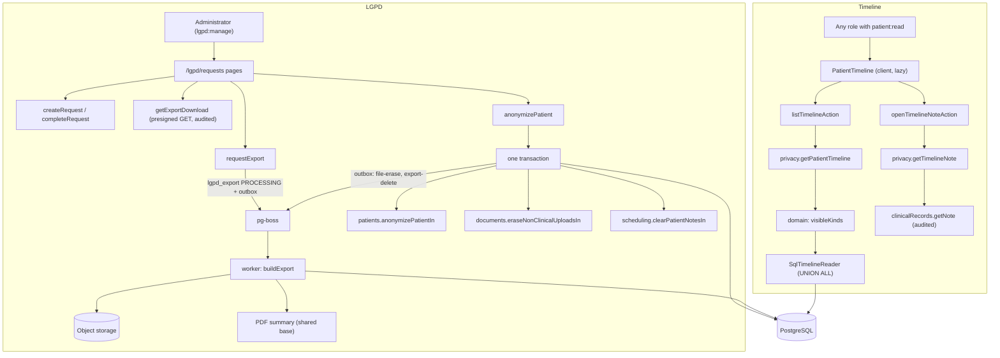

# Technical Specification: F14. Patient Timeline and LGPD Data Requests

**Complexity:** complex

## 1. Technical Overview

**What.** F14 in full (Core Scope plus Full Scope additions), in a new `privacy` module (rich tier, architecture section 3):
- **Patient timeline** (Core): the "Linha do tempo" tab of the patient page. It merges the patient's events from five modules in one list, newest first: patient registered and consent recorded (F05), appointments with their status history (F06), finalized clinical notes and addenda (F07), uploaded and generated documents (F08), and charges, payments and refunds (F09). The server filters by role: Front Desk users get no clinical events, Professionals get no financial events, and clinical items follow the F07 records policy. The list filters by event group and period, loads 50 events per page by infinite scroll, and answers in ≤ 2 seconds (p95). A clinical item expands to the full note, and each expansion is an audited read.
- **LGPD request register** (Full): "LGPD > Solicitações", for Administrators. Every access, correction and anonymization request is recorded with its date, requester, type, status and completion date. Requests pending for more than 15 days are highlighted.
- **LGPD data export** (Full): from an access request, a background job builds a ZIP with a JSON file of all the patient's data (F05–F09), a human-readable PDF summary, and every document, clinical attachment and consent file. It takes ≤ 5 minutes for up to 500 files. The ZIP can be downloaded from the request screen for 7 days and is then deleted. Generating the export and every download are audited with the requester and the reason. A failure sets "Falha na geração" with "Tentar novamente", and no partial file is ever offered.
- **Anonymization** (Full): from an anonymization request, after a two-step confirmation (a warning, then typing the patient's full name). The patient's identifiers are replaced by irreversible placeholders ("Paciente anonimizado #A1B2C3"). Non-clinical uploaded documents are erased. Appointments and financial records stay under the anonymized identity. It is refused while the patient has future appointments or open charges. When the patient has any clinical record, it is blocked and the request is registered as "Solicitação registrada — retenção legal" (Law 13.787/2018, architecture section 7).

**Why.**
- **The timeline is a read model, not a copy.** It is one `UNION ALL` query over the source tables, each branch narrowed by the patient index and the cursor. Nothing is projected, so the timeline cannot drift from the source records (ADR-036, ADR-037). Which event kinds a viewer may see is a pure domain rule built on existing policies. Hidden kinds are removed in SQL, never in the client.
- **Clinical content stays with `clinical-records`.** The timeline never selects note text. An expansion calls `clinicalRecords.getNote`, which applies the policy and writes the audit event.
- **The export is long work, so it runs in the worker** (architecture 5.5, ADR-008). The request commits a job row and an outbox message. The worker streams the stored files into a ZIP that is uploaded in parts, so memory stays bounded and 500 files of up to 20 MB fit in 5 minutes. The object is created only when the ZIP is complete, so a failure never leaves a partial file to download.
- **Anonymization changes data owned by other modules, so they do it.** Architecture section 3 forbids `privacy` from writing other modules' tables. `patients`, `documents` and `scheduling` therefore each expose a function that takes the caller's transaction (the pattern of ADR-035). `privacy` orchestrates them in one transaction, with every audit event inside it. Nothing referenced is hard-deleted (CLAUDE.md, F08): identifiers are overwritten, and an erased document keeps its row with its file removed. A database trigger then refuses any later change to an anonymized patient's identity, so the change is irreversible even if the application has a bug.

**How it fits the codebase.**
- **Reused as is:**
  - `patients.getPatientIdentity` (patient visibility, with the denial audited);
  - `clinicalRecords.canAccessPatientRecords` and `clinicalRecords.getNote`;
  - the permissions `patient:read`, `clinical:read`, `billing:operate`, `schedule:read-all`, `schedule:read-own` and `lgpd:manage` (Administrator, already in the matrix);
  - `withTransaction`, `authorize`, the transactional outbox and the dispatcher, pg-boss queues and schedules, `ObjectStorage` with presigned GET URLs, the shared PDF base (ADR-024), the formatters, `Stamp`, `Tabs`, and the dialog and table components.
- **New in this feature:**
  - the `privacy` module;
  - the `lgpd_request` and `lgpd_export` tables;
  - patient anonymization columns and an irreversibility trigger;
  - an erased state for patient documents;
  - three transactional functions in `patients`, `documents` and `scheduling`;
  - four queues and their jobs;
  - streamed uploads in `ObjectStorage`;
  - the `/lgpd/requests` pages;
  - the timeline tab;
  - ADR-040, design system sections 5.20 and 5.21, and the PRD clarifications.
- **New dependencies:**
  - `archiver` (streamed ZIP with ZIP64 for archives above 4 GB) and `@types/archiver`;
  - `@aws-sdk/lib-storage` (multipart upload of a stream).

### Scope

**Included:**
- Core Scope: the chronological patient timeline with role-based filtering of clinical items.
- Full Scope additions: the LGPD data export and the anonymization workflow.
- The LGPD data request register, with "LGPD > Solicitações", "Nova solicitação", statuses, the completion date and the 15-day highlight. *Resolved clarification:* the PRD lists the register under Capabilities without naming it in either scope block. The user placed it in the Full Scope, with export and anonymization, because it records that workflow's requests.
- Integrated from cross-cutting concerns:
  - authorization at the start of every use case (`patient:read` and the visibility policy for the timeline; `clinical:read` and the F07 policy for clinical items; `lgpd:manage` for every LGPD action, with denials audited);
  - tenancy (`forTenant` for Prisma access; explicit `organization_id` in raw SQL; cross-organization tests);
  - audit inside the same transaction for every mutation (request created, status changed, export requested, export finished or failed, export downloaded, patient anonymized, documents erased, notes cleared); clinical expansion audited by `getNote`; a timeline page that lists clinical items audited as F08 does;
  - no hard deletes of referenced records; files are removed from storage only for erased documents and expired exports;
  - clinical record retention of at least 20 years (PRD F14, Law 13.787/2018, architecture section 7), enforced by blocking anonymization;
  - per-currency money (ADR-029); unit and organization time zones (ADR-019, ADR-030);
  - three catalogs (pt-BR, en, es) for every screen, the PDF summary and the JSON labels (ADR-028);
  - the design system, extended with sections 5.20 (patient timeline) and 5.21 (LGPD requests).

**Deferred:**
- Package data (F10) in the export. F10 is outside F14's dependency closure. The export format reserves a `packages` key that a later change can fill.
- Correction requests are recorded and closed by hand. The correction itself is made in the F05 patient form, which already audits it.

**Input contracts (Consumes):**
- **F05:**
  - the complete patient record (`patient` columns, guardian, `patient_tag` with `tag`, referral source);
  - `consent_record` with `privacy_terms_version` and the consent file objects;
  - `patients.getPatientIdentity` for visibility.
- **F06:** `appointment` (times, status, `is_overbooking`, professional, service, unit, room, `created_by_id`, `notes`, cancellation fields), `appointment_status_change`, `appointment_reschedule`.
- **F07:**
  - `clinical_note` (state, times, `auto_finalized`, `content_html`, `content_text` for the export only), `clinical_note_version`, `clinical_note_addendum`, `clinical_attachment` (object keys), `clinical_alert` with its history;
  - `clinicalRecords.canAccessPatientRecords` and `clinicalRecords.getNote`.
- **F08:** `patient_document` (kind, title, category, `is_clinical`, status, `archived_at`, author, object keys) with `document_category`; the quota row `document_storage_usage`.
- **F09:** `charge` and `payment` (all money columns, method, units, users, dates).
- **F01:** the organization profile (name, logo) for the PDF summary; the requesting user's locale.

**Output contracts (Provides):**
- Timeline:
  - `privacy.getPatientTimeline(ctx, input)` → `TimelinePage`;
  - `privacy.getTimelineNote(ctx, input)` → `TimelineNote`.
- LGPD register:
  - `privacy.listRequests(ctx, input)`;
  - `privacy.getRequest(ctx, requestId)`;
  - `privacy.createRequest(ctx, input)`;
  - `privacy.completeRequest(ctx, input)`.
- Export:
  - `privacy.requestExport(ctx, input)`;
  - `privacy.getExportDownload(ctx, input)`;
  - `privacy.buildExport(job)`, `privacy.deleteExportFile(job)` and `privacy.cleanupExpiredExports(clock)` for the worker.
- Anonymization:
  - `privacy.previewAnonymization(ctx, requestId)`;
  - `privacy.anonymizePatient(ctx, input)`.
- UI and catalogs: `PatientTimeline`, `RequestsView`, `RequestDetail`, `privacyCatalog`.
- New functions in other modules, each taking the caller's `UnitOfWork`:
  - `patients.anonymizePatientIn`;
  - `documents.eraseNonClinicalUploadsIn` (plus the `documents.file-erase` job);
  - `scheduling.clearPatientNotesIn`.

### Traceability to the PRD

| PRD block | Where in this spec |
|---|---|
| Consumes (F05–F09) | Scope (input contracts); section 6 (tables read) |
| Core Scope (timeline, role filtering) | Decisions D2–D9; sections 4–6 |
| Full Scope additions (export, anonymization) | Decisions D10–D19; sections 4–6 |
| Capabilities: event types, role filtering, filters, 50 per page, p95 | Decisions D2–D9 |
| Capabilities: export (ZIP, JSON, PDF, files, 7 days, ≤ 5 min, logged) | Decisions D12–D15 |
| Capabilities: anonymization (placeholders, documents, records kept, clinical block) | Decisions D16–D19 |
| Capabilities: request register (types, statuses, 15 days) | Decisions D10, D11 |
| Experience: timeline tab; "LGPD > Solicitações"; two-step confirmation | Section 4 (frontend); design system 5.20 and 5.21 |
| Error Handling (export failure, clinical block, future/open block, name mismatch) | Section 5 (error codes and messages) |

## 2. Architecture Impact

### Affected components

| Component | Path | Change |
|---|---|---|
| Privacy module | `src/modules/privacy/` | New rich module: timeline, request register, export, anonymization |
| Patients module | `src/modules/patients/` | `anonymizePatientIn`; "Anonimizado" state on the patient page; read-only form for anonymized patients |
| Documents module | `src/modules/documents/` | `eraseNonClinicalUploadsIn`, erased state in the list, the `documents.file-erase` job, quota decrement |
| Scheduling module | `src/modules/scheduling/` | `clearPatientNotesIn` |
| Shared storage | `src/shared/storage/object-storage.ts` | `putStream(key, stream, contentType)` with multipart upload; `getStream(key)` |
| Outbox and queues | `src/shared/events/outbox.ts`, `src/shared/jobs/queues.ts`, `src/worker/outbox-dispatcher.ts`, `src/worker/index.ts`, `src/worker/jobs/privacy.ts` | Four new message types and queues; one daily schedule |
| Routes | `src/app/(app)/patients/[patientId]/`, `src/app/(app)/lgpd/requests/` | Timeline tab and actions; register list and request detail pages and actions |
| Navigation | `src/shared/ui/app-shell/navigation.ts` and the shell catalogs | "LGPD" group with "Solicitações" (`anyOf: ["lgpd:manage"]`) |
| Database | `prisma/schema.prisma`, `prisma/migrations/0016_privacy/` | Two tables, new columns, CHECKs, trigger, grants |
| Test helpers | `tests/integration/helpers.ts` | `lgpd_request` and `lgpd_export` in the truncate list |
| PRD | `docs/prd.en.md`, `docs/prd.pt-BR.md` | F14 clarifications (section 3 assumptions and resolved decisions) |
| Architecture | `docs/architecture.en.md`, `docs/architecture.pt-BR.md` | ADR-040; `privacy` arrows in the module graph; new jobs in section 5.5 |
| Design system | `docs/design-system.en.md`, `docs/design-system.pt-BR.md` | Sections 5.20 Patient timeline and 5.21 LGPD requests |

### Data flow



- `privacy` reads the other modules' tables through read-only SQL (architecture section 3). It writes only its own tables and the audit log. Every change to another module's data goes through that module's `...In(uow)` function.
- Storage deletions cannot join a database transaction. They are outbox messages written in the anonymization transaction, so the files are removed only after commit (architecture 5.4).
- New module dependency arrows: `patients`, `clinical-records`, `documents`, `scheduling`, `identity` → `privacy` (public API).

## 3. Technical Decisions

Batch mode. D1, D5 (order) and D3 (Administrator/Manager visibility) were confirmed by the user. The other decisions are spec-writer recommendations applied by the Auto-Accept Policy and are listed again under Assumptions for review.

| Decision | Chosen Approach | Alternative Considered | Trade-off |
|---|---|---|---|
| D1. Scope (**confirmed**) | Core + Full Scope, including the request register | Core only | A complex feature: one migration, background jobs, three other modules touched |
| D2. Timeline event model | Ten kinds in five groups:<br>`REGISTRATION`: `PATIENT_REGISTERED`, `CONSENT_RECORDED`<br>`APPOINTMENTS`: `APPOINTMENT`<br>`CLINICAL`: `CLINICAL_NOTE_FINALIZED`, `CLINICAL_ADDENDUM_ADDED`<br>`DOCUMENTS`: `DOCUMENT_UPLOADED`, `DOCUMENT_GENERATED`, each flagged clinical or not<br>`FINANCIAL`: `CHARGE_CREATED`, `PAYMENT_RECEIVED`, `PAYMENT_REFUNDED`<br>An appointment is one event at `starts_at`, carrying its current status and its status history | One event per status change | 50-event pages are not flooded by status changes; the history is one click away |
| D3. Visibility (**Administrator/Manager confirmed**) | Pure `visibleKinds({ clinical, financial })` plus an appointment scope:<br>`clinical` = `clinicalRecords.canAccessPatientRecords` (the F07 rule, also used by F08)<br>`financial` = `billing:operate`<br>own appointments only when the user has only `schedule:read-own` (F06)<br>Administrators and Managers see administrative and financial events, and clinical events only when linked to a professional who passes the F07 rule | New per-role timeline permissions | The timeline never shows more than the source screens |
| D4. Clinical content in the timeline | No note text and no preview in the list. "Ver registro" calls `getTimelineNote` → `clinicalRecords.getNote` (records policy and `READ_SENSITIVE` on `clinical_note`). No client cache, so every expansion is a new audited read | Showing a 150-character preview | Every display of clinical text is audited |
| D5. Order and paging (**order confirmed**) | Newest first, `ORDER BY occurred_at DESC, id DESC`; opaque keyset cursor `(occurred_at, id)`; each branch is cut to 51 rows before the union | Offset pages; oldest first | Stable pages; indexed branches |
| D6. Timeline filters | `groups` (empty = all visible) and an optional `from`/`to` local period in the organization zone; no maximum span. A group the viewer cannot see is dropped silently | Per-kind filters; a maximum span | Filtering never reveals hidden groups |
| D7. Loading | The tab loads on first open. Infinite scroll uses an `IntersectionObserver` sentinel, with "Carregar mais eventos" as the keyboard alternative and a polite live count | Server render with the patient page | Opening the patient page reads no clinical metadata |
| D8. Audit of a timeline page | A page listing clinical items records one `READ_SENSITIVE` on `patient` with the item ids, as F08 does for clinical documents | No audit of lists | Clinical metadata is health data |
| D9. Time zones | Appointments, charges and payments in their unit zone; other events in the organization zone; the period in the organization zone | Organization zone for everything | Local times stay correct per unit |
| D10. Request register model | `lgpd_request`: type `ACCESS`, `CORRECTION` or `ANONYMIZATION`; requester `PATIENT`, `GUARDIAN` or `REPRESENTATIVE`; description 10–2,000 characters (also the export reason); status `PENDING`, `PROCESSING`, `FAILED`, `COMPLETED` or `LEGAL_RETENTION`; `created_by_id` (staff), `completed_at`, `completed_by_id`, `resolution`. Creating, completing and every status change are audited | A free-text requester name | No extra personal data stored about the requester; the staff user and the requester kind answer "who" |
| D11. Overdue highlight | A request is open in `PENDING`, `PROCESSING` or `FAILED`. When open for more than 15 calendar days (organization zone, `LGPD_OVERDUE_DAYS = 15`), its row carries the warning stamp "Pendente há {days} dias". Open requests are listed first, oldest first | Highlight from day 15 | The PRD says "more than 15 days" |
| D12. Export pipeline | `requestExport` checks a request of type `ACCESS` that is not `COMPLETED`. In one transaction it inserts `lgpd_export` (`PROCESSING`), sets the request to `PROCESSING`, records `EXPORT` (requested) and writes the outbox message `privacy.export-build`. A partial unique index allows one `PROCESSING` export per request, so a double click cannot start two | A synchronous Route Handler | Up to 500 files and 5 minutes do not fit a request |
| D13. ZIP build | The worker streams with `archiver` (store mode for already-compressed files, deflate for JSON and PDF, ZIP64 automatically) into `ObjectStorage.putStream` (multipart). Files are read one at a time with `getStream`. Layout: `dados.json`, `resumo.pdf`, `arquivos/documentos/…`, `arquivos/anexos-clinicos/…`, `arquivos/consentimentos/…`. Entry names are `<id>-<sanitized file name>`. The key is `org/{orgId}/privacy/{uuid}.zip`, and the download name `dados-paciente-<request short id>.zip` holds no personal data | Building in memory; a temporary disk file | Bounded memory; a multipart upload that fails is aborted, so no object exists |
| D14. Export outcome | Success: export `READY` with size, file count, `ready_at` and `expires_at = ready_at + 7 days`; request `COMPLETED` with `completed_at`; audit `EXPORT` (generated, system actor). Any failure (missing object, storage or render error, the 5-minute budget exceeded): the multipart upload is aborted, export `FAILED` with an error code, request `FAILED`, audit. The job never throws, so pg-boss does not retry; "Tentar novamente" starts a new export row | Automatic retries | The user sees the failure at once and decides; no partial file is ever offered |
| D15. Download and expiry | `getExportDownload` authorizes, refuses when the export is not `READY` or is past `expires_at`, records `EXPORT` (downloaded) with the request id, the requester kind and the reason, and returns a 5-minute presigned GET URL (ADR-009). A daily job (`privacy-exports-cleanup`, 04:45) deletes the objects past `expires_at` and marks them `EXPIRED` | Keeping files until manually removed | The 7-day promise is enforced by both the use case and the job |
| D16. Anonymization eligibility | `previewAnonymization` and `anonymizePatient` share one rule set, checked in order:<br>(1) any clinical record — a clinical note in any state, a clinical document, or a clinical alert;<br>(2) future occupying appointments, or charges in `PENDING_APPROVAL`, `OPEN` or `PARTIALLY_PAID`;<br>(3) the typed name.<br>Rule (1) is not an error: it sets the request to `LEGAL_RETENTION` with `completed_at`, records the audit, and returns the outcome `LEGAL_RETENTION` with the PRD message. Rules (2) and (3) fail with no change | Checking the name first | Retention is recorded whatever is typed, because nothing personal changes |
| D17. What anonymization changes | In one transaction, with the patient row locked `FOR UPDATE` and the rules checked again:<br>`patients.anonymizePatientIn`: name, social name and normalized name become the placeholder; document, RG, phones, email, address, guardian, observations, occupation and referral source are cleared; `active = false`, `inactive_reason = 'ANONYMIZED'`, `anonymized_at`, `anonymized_code`<br>`documents.eraseNonClinicalUploadsIn`: non-clinical uploaded documents get `erased_at`, a placeholder title and file name, `archived_at` if unset, and the quota decremented; outbox `documents.file-erase` per object<br>`scheduling.clearPatientNotesIn`: appointment front-desk notes and cancellation notes set to null<br>Existing `READY` exports become `EXPIRED`, with outbox `privacy.export-delete`<br>The request becomes `COMPLETED`<br>Each step records its own audit event with **field names only, never the old values** | Deleting rows; copying old values aside | No hard delete; identity is gone from every table F14 controls; appointments, charges, payments, consents and generated documents keep their rows for statistics and accounting |
| D18. Irreversibility in the database | Migration trigger `trg_patient_anonymized_immutable`: when `OLD.anonymized_at IS NOT NULL`, it refuses any change to the identity columns and to `anonymized_at` and `anonymized_code`. The placeholder code is 6 random uppercase hexadecimal characters, unique per organization (partial unique index) | Application check only | Protects the erasure from bugs, as ADR-032 does for locked notes |
| D19. Anonymization confirmation | Step 1: a dialog with the irreversibility warning and the eligibility preview; blocking findings replace the next step. Step 2: a field to type the full name. The comparison trims, collapses spaces, and ignores case and accents (the F05 normalized form) against `full_name` | Exact comparison | Accent typing on another keyboard does not block; a different name still does |
| D20. Export contents | `dados.json` (`schemaVersion: 1`):<br>`generatedAt`, `organization`<br>`patient` (all F05 fields, tags, guardian)<br>`consents` (with file names)<br>`appointments` (with status history, reschedules and notes)<br>`clinicalNotes` (with HTML and text, versions, addenda, attachments), `clinicalAlert` (with its history)<br>`documents` (with metadata)<br>`charges` (with discount, payments and refunds)<br>`packages: null` (F10 is outside the closure)<br>`resumo.pdf`, in the requesting user's language: the same data as readable sections, with note texts, on the shared PDF base | Only a JSON file | Matches the PRD; readable by a person |
| D21. Clinical data in an Administrator's export | The worker reads clinical notes and attachments with a `SystemContext` and the read-only SQL of `privacy`. Opening the ZIP is outside the application, so the read is audited at generation (`EXPORT` with the note and attachment counts and ids). The PRD requires all patient data and names the Administrator as requester | Excluding clinical data; requiring a professional | A deliberate exception to the F07 "professionals only" rule for the LGPD right of access, recorded in ADR-040; see Conflicts |
| D22. Module tier | `privacy` is rich:<br>`domain/` holds the visibility rules, the cursor, the `LgpdRequest` entity (status machine), the `LgpdExport` entity (status and expiry), the eligibility rules, the name comparison and the placeholder code<br>`application/` holds the ports `TimelineReader`, `RequestRepository`, `ExportRepository`, `PatientDataReader`, `ExportArchive`, `ExportPdf`, `PatientGate`, `ClinicalGate` and `AnonymizationSteps` | Simple module | Real invariants (state machines, eligibility), so the tier fits |
| D23. Transport | Server Actions for every screen action. The download action returns a presigned URL that the client opens | Route Handlers | Same as F08; no file passes through the web process |

### Assumptions

Each item is a default applied where the PRD is silent (Auto-Accept Policy row in parentheses).

1. **Event times and authors** (Partial PRD specification).
   - Times:
     - registration: `created_at`; consent: `consented_at`;
     - note: `finalized_at` (drafts never appear; "Finalizado automaticamente" is shown);
     - addendum: `created_at`;
     - document: `created_at` (`FAILED` documents are excluded; archived and erased documents stay with a stamp);
     - charge: `created_at` (cancelled charges are stamped);
     - payment and refund: `received_at`.
   - Authors are the creating or recording user, or the note's professional; "—" when missing.
2. **Professionals see only their own appointments** in the timeline (F06), and still see other professionals' finalized notes (F07).
3. **No file access from the timeline.** Files open from the Documentos tab (F08) or the clinical record (F07).
4. **Requests per patient** (Technical recommendation).
   - Any number of access and correction requests is allowed.
   - Only one open anonymization request per patient (partial unique index), and none once the patient is anonymized.
5. **Request lifecycle** (Technical recommendation).
   - `ACCESS`: `PENDING` → `PROCESSING` → `COMPLETED` or `FAILED`. From `FAILED`, "Tentar novamente" returns to `PROCESSING`. After `COMPLETED`, "Gerar novamente" creates a new export, and the request stays `COMPLETED` with its first completion date.
   - `CORRECTION`: `PENDING` → `COMPLETED` through "Concluir solicitação", with a resolution of 10–2,000 characters.
   - `ANONYMIZATION`: `PENDING` → `COMPLETED` or `LEGAL_RETENTION`.
6. **Clinical alert counts as a clinical record** for the retention block (Description too vague). It is part of the F07 record.
7. **Kept after anonymization** (Description too vague; see Conflicts).
   - Kept as they are:
     - birth date and sex (age statistics);
     - tags;
     - consent records and their files (append-only legal evidence, migration 0006);
     - generated documents (the PRD erases only uploaded ones);
     - charge descriptions;
     - request descriptions;
     - earlier audit events.
   - Changed: appointment notes and cancellation notes are cleared, because free text may contain identifiers.
8. **Anonymized patients** are inactive (reason "Anonimizado"). They are hidden from booking searches by the F05 rule, and their form is read-only with an "Anonimizado" stamp. The timeline still works. Exporting them is allowed and contains the placeholders.
9. **Export limits** (Partial PRD specification).
   - The 5-minute budget is a named constant (`EXPORT_TIME_BUDGET_MS`); a run beyond it fails as in D14.
   - pg-boss `expireInSeconds` is 15 minutes.
   - There is no limit on file count, and 500 files is the measured target.
10. **Locale.** The PDF summary and the JSON labels use the language of the user who requested the export, stored on `lgpd_export`.
11. **Register screen** (Technical recommendation).
    - Route `/lgpd/requests`, with a table of 50 rows per page. Columns: Data, Paciente, Tipo, Solicitante, Status, Concluída em.
    - Filters: status ("Abertas" by default, "Todas", or each status) and type.
    - "Nova solicitação" is the primary button and opens a side panel (patient search, type, requester, description).
    - The detail page `/lgpd/requests/[requestId]` shows the request, its history and the type-specific action.
    - Sidebar: group "LGPD", item "Solicitações".
12. **Seeding** (Multiple conflicting patterns, most frequent).
    - Integration tests use `privacyWorld()` in `tests/integration/privacy/support.ts`. It reuses the billing, clinical and document helpers, writes rows directly where a date must be chosen, and puts small objects in SeaweedFS.
    - E2E journeys reuse the earlier journeys' clinic and add rows with `sql()`.
    - No static input files.
13. **Performance datasets** (Partial PRD specification).
    - Timeline: a patient with 10,000 events in an organization with 50,000 other appointments, 20 runs per view.
    - Export: a patient with 500 stored files of 1 MB to 20 MB (2 MB on average, about 1 GB in total), plus 500 appointments and 200 notes.
14. **Surfaces** (Contract surface set). The contract has `## UI`, `## Worker` and `## E2E`. There is no `## HTTP API` (Server Actions only) and no `## Service` (no external consumer).
15. **Quality gates** (Quality gates row): lint, typecheck, format check, unit tests, integration tests, migration drift check, E2E tests and the Docker image build. There is no wrapper script.
16. **Audit labels.** `READ_SENSITIVE` entries keep their action code. The PRD's display label "Leitura de dado sensível" is F15's concern.
17. **Audit entity metadata.** Every LGPD audit entry carries `metadata.patientId`, so the audit viewer can filter by patient.

### Conflicts and points for the user

- **Hard deletion vs. "deletes non-clinical uploaded documents".** The PRD says anonymization *deletes* those documents. CLAUDE.md and F08 forbid hard deletes of referenced records, and migration 0010 revokes `DELETE` on `patient_document`. Chosen: the row is kept as "erased" and only its stored file is deleted (D17). Confirm.
- **F07 "professionals only" vs. the Administrator's LGPD export with clinical notes** (D21). Chosen: allowed as the LGPD right of access, audited at generation. Confirm, or require a linked professional to approve exports that contain clinical data.
- **Personal data left after anonymization** (assumption 7). Earlier `audit_event` rows hold before/after values of patient edits, and the table is append-only (architecture 5.3). Consent files and generated PDFs contain the name and the CPF. They are kept as legal evidence. Confirm, or schedule a redaction ADR.
- **Packages (F10) are not in the export** (outside the dependency closure). Confirm whether a follow-up adds them.
- **Concurrency.** A booking made at the same instant as an anonymization is not serialized by the patient row lock, because scheduling does not lock the patient. The window is tiny and the anonymized patient becomes inactive. Accept, or add a `FOR SHARE` patient lock in booking.

## 4. Component Overview

### Frontend

| File Path | New/Modified | Purpose | Key Responsibilities |
|---|---|---|---|
| `src/app/(app)/patients/[patientId]/page.tsx` | Modified | Patient page | "Linha do tempo" tab for every user who can read the patient; "Anonimizado" stamp |
| `src/app/(app)/patients/[patientId]/timeline/actions.ts` | New | Server Actions | `listTimelineAction`, `openTimelineNoteAction` |
| `src/app/(app)/lgpd/requests/page.tsx` | New | Register list | `requirePermission("lgpd:manage")`, filters from the URL, `RequestsView` |
| `src/app/(app)/lgpd/requests/[requestId]/page.tsx` | New | Request detail | Loads `getRequest`, renders `RequestDetail` |
| `src/app/(app)/lgpd/requests/actions.ts` | New | Server Actions | `createRequestAction`, `completeRequestAction`, `requestExportAction`, `downloadExportAction`, `previewAnonymizationAction`, `anonymizePatientAction` |
| `src/modules/privacy/ui/patient-timeline.tsx`, `timeline-filters.tsx`, `timeline-list.tsx`, `timeline-item.tsx`, `timeline-note.tsx` | New | Timeline | Lazy first page, filters, month groups, items with stamps, history and note disclosures, sentinel and "Carregar mais eventos", live count, end line, empty and error states |
| `src/modules/privacy/ui/requests-view.tsx` | New | Register table | Filters, rows with status stamps and the overdue stamp, pagination, "Nova solicitação" |
| `src/modules/privacy/ui/new-request-panel.tsx` | New | Side panel | Patient search (F05 `PatientSearchField` via `@/modules/patients/client`), type, requester, description with counter |
| `src/modules/privacy/ui/request-detail.tsx` | New | Detail | Summary, history table, and per type: export block (status, "Gerar exportação", "Tentar novamente", "Baixar exportação", "Disponível até {date}", "Exportação expirada"), "Concluir solicitação", or "Anonimizar paciente" |
| `src/modules/privacy/ui/anonymize-dialog.tsx` | New | Two-step dialog | Step 1: warning and preview findings; step 2: name field and "Anonimizar definitivamente" (destructive); the PRD messages |
| `src/shared/ui/app-shell/navigation.ts` | Modified | Sidebar | "LGPD" group, "Solicitações" item |

**Design system additions (both languages, before the screens are built):**
- **Section 5.20 Patient timeline:**
  - A vertical `<ol>` under month headings in `group-title`, with a 1 px `rule` line on the left edge.
  - Each event has a 16 px icon beside its title in `body-strong`, the date and time in tabular `meta`, the summary in `body`, "por {name}" in `meta`, and stamps for its states.
  - Ghost disclosures "Ver histórico" and "Ver registro" with `aria-expanded`; an expanded note sits in the reading column, with addenda as in 5.12.
  - A filter bar with checkboxes for the visible groups, "De" and "Até", and "Limpar filtros". There is no primary button.
  - Below the list: a sentinel, "Carregar mais eventos" as a secondary button, a polite live count, and "Fim da linha do tempo.".
  - Works at 375 px and at 200% zoom.
- **Section 5.21 LGPD requests:**
  - The register is a table (5.4).
  - Statuses are stamps: Pendente (neutral), Em geração (info), Falha na geração (danger), Concluída (success), Solicitação registrada — retenção legal (warning).
  - The overdue mark is an extra warning stamp "Pendente há {days} dias", never color alone.
  - The detail page shows a definition list for the request, the history as a compact table, and one action block per type:
    - Export block: a status line in `meta` with a live region ("Gerando exportação…"), "Baixar exportação" as the primary button while the file is available, "Disponível até {date}" in `meta`, and "Tentar novamente" (secondary) after a failure.
    - Anonymization dialog: an alert dialog of two steps. Step 1 is the danger page alert with the irreversibility text and the eligibility findings. Step 2 is the name field and the destructive button "Anonimizar definitivamente". Blocking findings replace step 2 with their PRD message.

### Backend

| File Path | New/Modified | Purpose | Key Responsibilities |
|---|---|---|---|
| `src/modules/privacy/index.ts` | New | Public API | `createPrivacy(adjust?)`, `privacy`, catalog, UI, types, worker entry points |
| `src/modules/privacy/domain/timeline-event.ts`, `visibility.ts`, `cursor.ts` | New | Timeline rules | Kinds and groups; `visibleKinds`, `requestedKinds`; cursor encode/decode |
| `src/modules/privacy/domain/lgpd-request.ts` | New | Entity | Status machine (D10, assumption 5), `isOpen`, `daysOpen(today)`, `isOverdue(today)` |
| `src/modules/privacy/domain/lgpd-export.ts` | New | Entity | `PROCESSING → READY \| FAILED`, `READY → EXPIRED`, `isDownloadable(now)` |
| `src/modules/privacy/domain/eligibility.ts` | New | Rules | `anonymizationFindings(facts)` → `LEGAL_RETENTION`, `BLOCKED_FUTURE_OR_OPEN`, or eligible |
| `src/modules/privacy/domain/anonymization.ts` | New | Rules | `namesMatch(typed, fullName)`, `placeholderName(code)`, `newAnonymizationCode(random)` |
| `src/modules/privacy/domain/limits.ts` | New | Named constants | `TIMELINE_PAGE_SIZE = 50`, `TIMELINE_P95_MS = 2_000`, `LGPD_OVERDUE_DAYS = 15`, `EXPORT_AVAILABILITY_DAYS = 7`, `EXPORT_TIME_BUDGET_MS = 300_000`, `EXPORT_FILE_TARGET = 500`, `REQUEST_DESCRIPTION_MIN/MAX = 10/2_000`, each with its PRD F14 reference |
| `src/modules/privacy/domain/errors.ts` | New | Errors | Section 5 codes |
| `src/modules/privacy/application/ports.ts` | New | Ports | D22 ports and `PrivacyDeps` (clock, random) |
| `src/modules/privacy/application/schemas.ts` | New | Zod | Timeline query, note, list requests, create, complete, export, download, anonymize |
| `src/modules/privacy/application/timeline.ts` | New | Use cases | `getPatientTimeline`, `getTimelineNote` |
| `src/modules/privacy/application/requests.ts` | New | Use cases | `listRequests`, `getRequest`, `createRequest`, `completeRequest` |
| `src/modules/privacy/application/exports.ts` | New | Use cases | `requestExport`, `getExportDownload`, `buildExport` (worker), `deleteExportFile`, `cleanupExpiredExports` |
| `src/modules/privacy/application/anonymization.ts` | New | Use cases | `previewAnonymization`, `anonymizePatient` |
| `src/modules/privacy/application/export-content.ts` | New | Mapping | Builds the JSON document and the PDF model from `PatientDataReader` rows |
| `src/modules/privacy/infrastructure/sql-timeline-reader.ts` | New | Adapter | Timeline `UNION ALL` and status-history query |
| `src/modules/privacy/infrastructure/sql-patient-data-reader.ts` | New | Adapter | Export reads and eligibility facts, explicit `organization_id` |
| `src/modules/privacy/infrastructure/prisma-request-repository.ts`, `prisma-export-repository.ts` | New | Adapters | Own tables through `uow.tx` |
| `src/modules/privacy/infrastructure/zip-archive.ts` | New | Adapter | `archiver` stream → `ObjectStorage.putStream`; abort on error |
| `src/modules/privacy/infrastructure/export-pdf.tsx` | New | Adapter | Summary on the shared PDF base |
| `src/modules/privacy/infrastructure/directory.ts` | New | Adapter | `PatientGate`, `ClinicalGate`, `AnonymizationSteps` over `patients`, `clinicalRecords`, `documents`, `scheduling` |
| `src/modules/privacy/messages/{pt-BR,en,es}.json`, `catalog.ts` | New | Catalogs | `privacy.ui`, `events`, `groups`, `requests`, `exports`, `anonymization`, `pdf`, `json`, `validation`, `errors` |
| `src/modules/patients/application/anonymize.ts` | New | Transactional function | `anonymizePatientIn(ctx, uow, { patientId, code })`; audit `UPDATE` with field names only |
| `src/modules/documents/application/erasure.ts` | New | Transactional function and job | `eraseNonClinicalUploadsIn(ctx, uow, patientId)` → erased count and keys; `eraseDocumentFile(job)` deletes the objects |
| `src/modules/scheduling/application/clear-notes.ts` | New | Transactional function | `clearPatientNotesIn(ctx, uow, patientId)`; audit with counts |
| `src/shared/storage/object-storage.ts` | Modified | Storage | `putStream` (multipart via `@aws-sdk/lib-storage`, aborted on error), `getStream` |
| `src/shared/events/outbox.ts`, `src/shared/jobs/queues.ts`, `src/worker/outbox-dispatcher.ts` | Modified | Jobs | Types and queues `privacy.export-build`, `privacy.export-delete`, `documents.file-erase`, cron queue `privacy-exports-cleanup` |
| `src/worker/index.ts`, `src/worker/jobs/privacy.ts` | Modified / New | Worker | Handlers and the daily schedule at 04:45 |
| `src/composition.ts` | Modified | Composition | `registerCatalog("privacy", privacyCatalog)` |

### Database

| Migration File | Tables Affected | Operation | Notes |
|---|---|---|---|
| `prisma/migrations/0016_privacy/migration.sql` | `lgpd_request`, `lgpd_export` | CREATE | Tables, CHECKs, indexes, partial uniques, grants without `DELETE` |
| same | `patient` | ALTER | `anonymized_at`, `anonymized_code`; `ANONYMIZED` inactive reason; phone CHECK accepts the anonymized empty value; partial unique code; irreversibility trigger |
| same | `patient_document` | ALTER | `erased_at`, `erased_by_id`; CHECK that only non-clinical uploads can be erased |

## 5. API Contracts

All screen operations are Server Actions returning the `ActionResult` envelope with `toActionResult(..., "privacy")`.

### Error codes

| Code | HTTP | pt-BR message (catalog `privacy`) |
|---|---|---|
| `PRIVACY_PERIOD_INVALID` | 400 | A data final deve ser igual ou posterior à data inicial. |
| `PRIVACY_CURSOR_INVALID` | 400 | Não foi possível continuar a lista. Recarregue a linha do tempo. |
| `PRIVACY_PATIENT_NOT_FOUND` | 404 | Paciente não encontrado. |
| `PRIVACY_NOTE_NOT_FOUND` | 404 | Registro clínico não encontrado. |
| `PRIVACY_REQUEST_NOT_FOUND` | 404 | Solicitação não encontrada. |
| `PRIVACY_REQUEST_CLOSED` | 409 | Esta solicitação já foi concluída. |
| `PRIVACY_REQUEST_TYPE_MISMATCH` | 409 | Esta ação não se aplica a este tipo de solicitação. |
| `PRIVACY_ANONYMIZATION_REQUEST_OPEN` | 409 | Já existe uma solicitação de anonimização em aberto para este paciente. |
| `PRIVACY_PATIENT_ANONYMIZED` | 409 | Este paciente já foi anonimizado. |
| `PRIVACY_EXPORT_IN_PROGRESS` | 409 | A exportação já está sendo gerada. |
| `PRIVACY_EXPORT_NOT_READY` | 409 | A exportação ainda não está disponível. |
| `PRIVACY_EXPORT_EXPIRED` | 410 | Esta exportação expirou em {date}. Gere uma nova exportação. |
| `PRIVACY_ANONYMIZATION_BLOCKED` | 409 | Cancele os agendamentos futuros e regularize as cobranças em aberto antes de anonimizar. |
| `PRIVACY_NAME_MISMATCH` | 422 | O nome digitado não confere. |
| `VALIDATION_FAILED` (shared) | 400 | Field messages from `privacy.validation.*` (for example "Descreva a solicitação com pelo menos 10 caracteres.") |
| `AUTHZ_FORBIDDEN` (shared) | 403 | The shared forbidden message; the denial is audited |

Outcome texts (not errors):
- Clinical retention: "Este paciente possui registros clínicos, que devem ser mantidos por no mínimo 20 anos (Lei 13.787/2018). A solicitação foi registrada e os dados não clínicos podem ser corrigidos, mas não anonimizados."
- Status stamp: "Solicitação registrada — retenção legal".
- Success toast: "Paciente anonimizado."
- Export failure status: "Falha na geração", with the button "Tentar novamente".

### Timeline texts (pt-BR source)

| Key | pt-BR |
|---|---|
| `ui.tab` / `ui.filtersLabel` | Linha do tempo / Filtros da linha do tempo |
| `groups.*` | Cadastro e consentimento / Agendamentos / Registros clínicos / Documentos / Financeiro |
| `events.PATIENT_REGISTERED` / `CONSENT_RECORDED` / `APPOINTMENT` | Paciente cadastrado / Consentimento registrado / Agendamento |
| `events.CLINICAL_NOTE_FINALIZED` / `CLINICAL_ADDENDUM_ADDED` | Registro clínico finalizado / Adendo adicionado |
| `events.DOCUMENT_UPLOADED` / `DOCUMENT_GENERATED` | Documento enviado / Documento emitido |
| `events.CHARGE_CREATED` / `PAYMENT_RECEIVED` / `PAYMENT_REFUNDED` | Cobrança {number} criada / Pagamento recebido / Estorno registrado |
| `ui.showNote` / `ui.hideNote` / `ui.showHistory` / `ui.hideHistory` | Ver registro / Ocultar registro / Ver histórico / Ocultar histórico |
| `ui.addendumBy` | Adendo de {author} em {dateTime} |
| `ui.loadMore` / `ui.loadedCount` / `ui.end` | Carregar mais eventos / {count, plural, one {# evento carregado} other {# eventos carregados}} / Fim da linha do tempo. |
| `ui.empty` / `ui.loadError` / `ui.retry` | Nenhum evento para os filtros selecionados. / Não foi possível carregar a linha do tempo. Tente novamente. / Tentar novamente |

### LGPD texts (pt-BR source)

| Key | pt-BR |
|---|---|
| `requests.menuGroup` / `requests.menuItem` / `requests.title` | LGPD / Solicitações / Solicitações LGPD |
| `requests.new` / `requests.submit` / `requests.created` | Nova solicitação / Registrar solicitação / Solicitação registrada. |
| `requests.columns.*` | Data / Paciente / Tipo / Solicitante / Status / Concluída em |
| `requests.types.*` | Acesso / Correção / Anonimização |
| `requests.requestedBy.*` | Paciente / Responsável / Representante legal |
| `requests.statuses.*` | Pendente / Em geração / Falha na geração / Concluída / Solicitação registrada — retenção legal |
| `requests.overdue` | Pendente há {days} dias |
| `requests.filters.open` / `requests.filters.all` | Abertas / Todas |
| `requests.complete` / `requests.resolution` | Concluir solicitação / Resolução |
| `validation.descriptionMin` | Descreva a solicitação com pelo menos 10 caracteres. |
| `exports.generate` / `exports.generating` / `exports.retry` / `exports.again` | Gerar exportação / Gerando exportação… / Tentar novamente / Gerar novamente |
| `exports.download` / `exports.availableUntil` / `exports.expiredOn` | Baixar exportação / Disponível até {date} / Exportação expirada em {date} |
| `anonymization.start` / `anonymization.warningTitle` | Anonimizar paciente / Anonimizar dados do paciente |
| `anonymization.warning` | A anonimização substitui definitivamente o nome, os documentos, os contatos, o endereço e os dados do responsável, e remove os documentos não clínicos enviados. Esta ação não pode ser desfeita. |
| `anonymization.continue` / `anonymization.typeName` / `anonymization.confirm` | Continuar / Digite o nome completo do paciente para confirmar / Anonimizar definitivamente |
| `anonymization.done` / `anonymization.stamp` / `anonymization.placeholder` | Paciente anonimizado. / Anonimizado / Paciente anonimizado #{code} |

### Action: `listTimelineAction`

- **Authorization:** `patient:read` plus the patient visibility policy.
- **Input:**

| Field | Type | Required | Validation |
|---|---|---|---|
| `patientId` | uuid | yes | a patient of the organization |
| `groups` | string[] | no | each one of the five groups; no duplicates |
| `from`, `to` | `YYYY-MM-DD` | no | both or neither; `to ≥ from` |
| `cursor` | string | no | an opaque cursor from a previous page |

```json
{ "patientId": "01927a4e-5b1c-7d3e-9f00-1a2b3c4d5e6f", "groups": [], "from": null, "to": null, "cursor": null }
```

- **Response (`TimelinePage`):** `items` (≤ 50), `nextCursor`, `pageSize`, `visibleGroups`, `organizationTimeZone`.
  - Each item carries `key`, `kind`, `group`, `occurredAt`, `timeZone` and `authorName`, plus the fields of its kind:

| Kind | Fields |
|---|---|
| `CONSENT_RECORDED` | `termsVersion`, `method` |
| `APPOINTMENT` | `appointmentId`, `status`, `serviceName`, `professionalName`, `unitName`, `roomName`, `isOverbooking`, `rescheduleCount`, `history[]` (`toStatus`, `changedAt`, `changedByName`) |
| `CLINICAL_NOTE_FINALIZED` | `noteId`, `professionalName`, `serviceName`, `autoFinalized`, `addendaCount` |
| `CLINICAL_ADDENDUM_ADDED` | `noteId`, `addendumId`, `professionalName` |
| `DOCUMENT_*` | `documentId`, `title`, `categoryName`, `clinical`, `archived`, `erased` |
| `CHARGE_CREATED` | `chargeId`, `number`, `origin`, `itemName`, `netMinor` (string), `currency`, `status` |
| `PAYMENT_*` | `paymentId`, `chargeNumber`, `method`, `amountMinor` (string), `currency` |

```json
{
  "items": [
    {
      "key": "CLINICAL_NOTE_FINALIZED:01927a52-0000-7000-8000-000000000201",
      "kind": "CLINICAL_NOTE_FINALIZED", "group": "CLINICAL",
      "occurredAt": "2026-10-06T14:10:00.000Z", "timeZone": "America/Sao_Paulo",
      "authorName": "Dra. Paula", "noteId": "01927a52-0000-7000-8000-000000000201",
      "professionalName": "Dra. Paula", "serviceName": "Consulta", "autoFinalized": false, "addendaCount": 1
    }
  ],
  "nextCursor": "eyJ0IjoiMjAyNi0xMC0wNlQxNDoxMDowMC4wMDBaIn0",
  "pageSize": 50,
  "visibleGroups": ["REGISTRATION", "APPOINTMENTS", "CLINICAL", "DOCUMENTS"],
  "organizationTimeZone": "America/Sao_Paulo"
}
```

- **Audit:** only when the page lists clinical items.

```json
{ "action": "READ_SENSITIVE", "entityType": "patient", "entityId": "…", "summary": "Linha do tempo com itens clínicos consultada", "metadata": { "patientId": "…", "noteIds": ["…"], "addendumIds": [], "documentIds": [] } }
```

### Action: `openTimelineNoteAction`

- **Authorization:** `clinical:read`, then the F07 policy inside `clinicalRecords.getNote`.
- **Input:** `{ "patientId": "…", "noteId": "…" }`.
- **Response (`TimelineNote`):** `noteId`, `professionalName`, `serviceName`, `finalizedAt`, `autoFinalized`, `html` (sanitized), `addenda[]` (`authorName`, `createdAt`, `html`), `attachments[]` (`fileName`, `inError`), `timeZone`.
- **Audit:** `READ_SENSITIVE` on `clinical_note`, written by `getNote`.
- A note of another patient returns `PRIVACY_NOTE_NOT_FOUND`.

### Action: `createRequestAction`

- **Authorization:** `lgpd:manage` (Administrator).
- **Input:**

| Field | Type | Required | Validation |
|---|---|---|---|
| `patientId` | uuid | yes | a patient of the organization |
| `type` | enum | yes | `ACCESS`, `CORRECTION`, `ANONYMIZATION` |
| `requestedBy` | enum | yes | `PATIENT`, `GUARDIAN`, `REPRESENTATIVE` |
| `description` | string | yes | 10–2,000 characters after trimming |

```json
{ "patientId": "…", "type": "ACCESS", "requestedBy": "PATIENT", "description": "Paciente pediu cópia de todos os seus dados por e-mail em 14/10." }
```

- **Response:** `{ "requestId": "…", "status": "PENDING" }`.
- **Audit:** `CREATE` on `lgpd_request`.
- **Errors:**
  - `PRIVACY_ANONYMIZATION_REQUEST_OPEN` when an anonymization request is already open for the patient;
  - `PRIVACY_PATIENT_ANONYMIZED` for a new anonymization request on a patient already anonymized.

### Action: `listRequests` (page data)

- **Input:** `status` (`OPEN` default, `ALL`, or one status), `type` (`ALL` or one type), `page`.
- **Response:**

```json
{
  "items": [
    { "id": "…", "createdAt": "2026-10-01T13:00:00.000Z", "patientDisplayName": "Lia Fernandes", "type": "ACCESS",
      "requestedBy": "PATIENT", "status": "PENDING", "completedAt": null, "daysOpen": 17, "overdue": true }
  ],
  "page": 1, "pageSize": 50, "total": 1, "openOverdueCount": 1
}
```

### Action: `completeRequestAction` (correction requests)

- **Input:** `{ "requestId": "…", "resolution": "Telefone corrigido no cadastro em 15/10." }`, with a resolution of 10–2,000 characters.
- **Response:** `{ "status": "COMPLETED", "completedAt": "…" }`.
- **Audit:** `UPDATE` on `lgpd_request`.

### Action: `requestExportAction`

- **Input:** `{ "requestId": "…" }`.
- **Response:** `{ "exportId": "…", "status": "PROCESSING" }`.
- **Audit:** `EXPORT` on `lgpd_request` with `metadata { patientId, exportId, phase: "requested", requestedBy, reason }`.
- **Errors:** `PRIVACY_REQUEST_TYPE_MISMATCH`, `PRIVACY_EXPORT_IN_PROGRESS`.

### Worker job `privacy.export-build`

- **Payload:** `{ "organizationId": "…", "exportId": "…" }`.
- **On success:**
  - the export is `READY` with `objectKey`, `sizeBytes`, `fileCount`, `readyAt` and `expiresAt`;
  - the request is `COMPLETED`;
  - audit `EXPORT` (system actor) with `metadata { patientId, exportId, phase: "generated", fileCount, noteIds, attachmentIds, durationMs }`.
- **On failure:** the export and the request are `FAILED` with `errorCode` (`FILE_MISSING`, `STORAGE_ERROR`, `RENDER_ERROR`, `TIME_BUDGET_EXCEEDED`); audit `UPDATE`; no object.

### Action: `downloadExportAction`

- **Input:** `{ "exportId": "…" }`.
- **Response:** `{ "url": "https://…presigned…", "fileName": "dados-paciente-7f3a2c.zip", "expiresAt": "2026-10-25T13:05:00.000Z" }`.
- **Audit:** `EXPORT` with `metadata { patientId, requestId, exportId, phase: "downloaded", requestedBy, reason }`.
- **Errors:** `PRIVACY_EXPORT_NOT_READY`, `PRIVACY_EXPORT_EXPIRED`.

### Action: `previewAnonymizationAction`

- **Input:** `requestId`.
- **Response:** `{ "outcome": "ELIGIBLE" | "LEGAL_RETENTION" | "BLOCKED", "findings": { "clinicalNotes": 0, "clinicalDocuments": 0, "clinicalAlert": false, "futureAppointments": 0, "openCharges": 0 }, "patientDisplayName": "…" }`.
- No change and no audit (it reads no personal content).

### Action: `anonymizePatientAction`

- **Input:** `{ "requestId": "…", "typedName": "Rafael Mendes Costa", "version": 3 }` (`version` is the request's optimistic version).
- **Responses:**
  - `{ "outcome": "ANONYMIZED", "placeholder": "Paciente anonimizado #A1B2C3", "erasedDocuments": 2 }`;
  - `{ "outcome": "LEGAL_RETENTION" }` (the request is now `LEGAL_RETENTION`, and the UI shows the retention text).
- **Errors:** `PRIVACY_ANONYMIZATION_BLOCKED`, `PRIVACY_NAME_MISMATCH`, `PRIVACY_REQUEST_CLOSED`, `PRIVACY_PATIENT_ANONYMIZED`, `CONFLICT_STALE_VERSION`.
- **Audit (same transaction):**
  - `UPDATE` on `patient` (`summary: "Paciente anonimizado"`, `changes` lists field names only);
  - `UPDATE` on each erased `patient_document`;
  - `UPDATE` on `appointment` with `metadata { patientId, clearedNotes }`;
  - `UPDATE` on each expired `lgpd_export`;
  - `UPDATE` on `lgpd_request`.

## 6. Data Model

### Table: `lgpd_request`

| Column | Type | Nullable | Default | Description |
|---|---|---|---|---|
| `id` | `uuid` | No | — | UUIDv7 |
| `organization_id` | `uuid` | No | — | Tenant |
| `patient_id` | `uuid` | No | — | FK `patient`, `ON DELETE RESTRICT` |
| `type` | `varchar(16)` | No | — | `ACCESS`, `CORRECTION`, `ANONYMIZATION` |
| `requested_by` | `varchar(16)` | No | — | `PATIENT`, `GUARDIAN`, `REPRESENTATIVE` |
| `description` | `varchar(2000)` | No | — | Reason; 10+ characters |
| `status` | `varchar(20)` | No | `'PENDING'` | `PENDING`, `PROCESSING`, `FAILED`, `COMPLETED`, `LEGAL_RETENTION` |
| `resolution` | `varchar(2000)` | Yes | — | Correction outcome |
| `created_by_id` | `uuid` | No | — | Staff user |
| `created_at` | `timestamptz` | No | `now()` | Request date |
| `completed_at` | `timestamptz` | Yes | — | Completion date |
| `completed_by_id` | `uuid` | Yes | — | User or null for the worker |
| `version` | `integer` | No | `1` | Optimistic lock |
| `updated_at` | `timestamptz` | No | `now()` | — |

**Constraints and indexes:**

| Name | Type | Definition | Purpose |
|---|---|---|---|
| `ck_lgpd_request_type`, `ck_lgpd_request_requested_by`, `ck_lgpd_request_status` | CHECK | value lists | Closed vocabularies |
| `ck_lgpd_request_description` | CHECK | `char_length(btrim(description)) >= 10` | PRD reason |
| `ck_lgpd_request_completion` | CHECK | `(status IN ('COMPLETED','LEGAL_RETENTION')) = (completed_at IS NOT NULL)` | Completion date only when closed |
| `ck_lgpd_request_retention_type` | CHECK | `status <> 'LEGAL_RETENTION' OR type = 'ANONYMIZATION'` | Retention applies only to anonymization |
| `uq_lgpd_request_open_anonymization` | UNIQUE (partial) | `(organization_id, patient_id) WHERE type = 'ANONYMIZATION' AND status IN ('PENDING','PROCESSING','FAILED')` | One open anonymization per patient |
| `ix_lgpd_request_org_status_created` | btree | `(organization_id, status, created_at)` | Register list and overdue |
| `ix_lgpd_request_org_patient` | btree | `(organization_id, patient_id, created_at DESC)` | Per patient |

### Table: `lgpd_export`

| Column | Type | Nullable | Default | Description |
|---|---|---|---|---|
| `id` | `uuid` | No | — | UUIDv7 |
| `organization_id` | `uuid` | No | — | Tenant |
| `request_id` | `uuid` | No | — | FK `lgpd_request`, `RESTRICT` |
| `status` | `varchar(12)` | No | `'PROCESSING'` | `PROCESSING`, `READY`, `FAILED`, `EXPIRED` |
| `locale` | `varchar(5)` | No | — | Language of the PDF and JSON labels |
| `object_key` | `varchar(200)` | Yes | — | Present only while `READY` |
| `size_bytes` | `bigint` | Yes | — | ZIP size |
| `file_count` | `integer` | Yes | — | Files included |
| `error_code` | `varchar(30)` | Yes | — | Failure reason |
| `requested_by_id` | `uuid` | No | — | Administrator |
| `requested_at` | `timestamptz` | No | `now()` | — |
| `ready_at`, `expires_at`, `failed_at`, `expired_at` | `timestamptz` | Yes | — | Lifecycle |

| Name | Type | Definition | Purpose |
|---|---|---|---|
| `ck_lgpd_export_status` | CHECK | value list | — |
| `ck_lgpd_export_ready` | CHECK | `(status = 'READY') = (object_key IS NOT NULL)` | Never a key for a failed or partial file |
| `ck_lgpd_export_expiry` | CHECK | `status <> 'READY' OR expires_at = ready_at + interval '7 days'` | PRD 7 days |
| `uq_lgpd_export_processing` | UNIQUE (partial) | `(request_id) WHERE status = 'PROCESSING'` | One build at a time |
| `ix_lgpd_export_ready_expiry` | btree (partial) | `(expires_at) WHERE status = 'READY'` | Cleanup job |
| `ix_lgpd_export_request` | btree | `(organization_id, request_id, requested_at DESC)` | Detail page |

### Changes to `patient` and `patient_document`

| Change | Definition |
|---|---|
| `patient.anonymized_at timestamptz NULL`, `patient.anonymized_code char(6) NULL` | Anonymization marks |
| `uq_patient_anonymized_code` | `UNIQUE (organization_id, anonymized_code) WHERE anonymized_code IS NOT NULL` |
| `ck_patient_inactive_reason` | Recreated with `ANONYMIZED` added |
| Mobile phone CHECK (current name in migrations 0006/0008) | Recreated so that `mobile_phone = ''` is accepted only when `anonymized_at IS NOT NULL` |
| `ck_patient_anonymized` | `(anonymized_at IS NULL) = (anonymized_code IS NULL)` and, when set, `active = false` |
| `trg_patient_anonymized_immutable` (BEFORE UPDATE) | When `OLD.anonymized_at IS NOT NULL`, raises if any identity column, `anonymized_at` or `anonymized_code` changes |
| `patient_document.erased_at timestamptz NULL`, `erased_by_id uuid NULL` | Erased state |
| `ck_patient_document_erasable` | `erased_at IS NULL OR (kind = 'UPLOADED' AND is_clinical = false)` |

**Migration excerpt (illustrative):**

```sql
CREATE TABLE lgpd_request (
  id UUID PRIMARY KEY,
  organization_id UUID NOT NULL REFERENCES organization(id),
  patient_id UUID NOT NULL REFERENCES patient(id) ON DELETE RESTRICT,
  type VARCHAR(16) NOT NULL,
  requested_by VARCHAR(16) NOT NULL,
  description VARCHAR(2000) NOT NULL,
  status VARCHAR(20) NOT NULL DEFAULT 'PENDING',
  resolution VARCHAR(2000),
  created_by_id UUID NOT NULL REFERENCES app_user(id),
  created_at TIMESTAMPTZ NOT NULL DEFAULT now(),
  completed_at TIMESTAMPTZ,
  completed_by_id UUID REFERENCES app_user(id),
  version INTEGER NOT NULL DEFAULT 1,
  updated_at TIMESTAMPTZ NOT NULL DEFAULT now()
);
CREATE UNIQUE INDEX uq_lgpd_request_open_anonymization ON lgpd_request (organization_id, patient_id)
  WHERE type = 'ANONYMIZATION' AND status IN ('PENDING', 'PROCESSING', 'FAILED');
REVOKE DELETE ON lgpd_request, lgpd_export FROM gcli_app;
```

### Timeline query

The timeline uses one branch per kind over the existing indexes:
- `ix_consent_patient_time`;
- `ix_appointment_org_patient_start`;
- `ix_clinical_note_org_patient_created`, with `ix_clinical_addendum_note` for addenda;
- `ix_patient_document_list`;
- `ix_charge_patient`, with `ix_payment_charge` for payments.

How the query is built:
- Each branch filters `organization_id` and `patient_id`, applies the allowed kinds, the window and the cursor, and ends with `ORDER BY occurred_at DESC, id DESC LIMIT 51`.
- The outer query unions the branches and keeps 51 rows.
- Every branch returns `kind`, `id`, `occurred_at`, `time_zone`, `author_name` and `payload jsonb`.
- A second query reads the status history of the page's appointments.
- Clinical documents are excluded in SQL for viewers without clinical access.

### Export reads and eligibility facts

- **Export:** one read query per section, ordered by date and with explicit `organization_id`. The files are listed with their object keys:
  - `patient_document` that is not erased, with `object_key` or else `source_object_key`;
  - `clinical_attachment` (`object_key` or `source_object_key`);
  - `consent_record.file_object_key`.
- **Facts:** counts of `clinical_note`, of `patient_document` with `is_clinical`, and of `clinical_alert` rows with text; future appointments with `starts_at > now()` and a status other than `CANCELLED` or `NO_SHOW`; charges in `PENDING_APPROVAL`, `OPEN` or `PARTIALLY_PAID`.

## 7. Testing Strategy

### Test files

| File | Kind |
|---|---|
| `src/modules/privacy/domain/visibility.test.ts`, `cursor.test.ts`, `timeline-event.test.ts` | Unit |
| `src/modules/privacy/domain/lgpd-request.test.ts`, `lgpd-export.test.ts`, `eligibility.test.ts`, `anonymization.test.ts` | Unit |
| `src/modules/privacy/application/export-content.test.ts` | Unit (JSON shape from fixed rows) |
| `tests/integration/privacy/support.ts` | `privacyWorld()` and helpers |
| `tests/integration/privacy/timeline.test.ts`, `visibility.test.ts`, `note-read.test.ts`, `timeline-performance.test.ts` | Integration |
| `tests/integration/privacy/requests.test.ts`, `exports.test.ts`, `export-performance.test.ts`, `anonymization.test.ts`, `schema.test.ts` | Integration |
| `tests/e2e/f14-patient-timeline.spec.ts`, `tests/e2e/f14-lgpd-requests.spec.ts` | Playwright |

### Unit tests

| Test Function | Assertions |
|---|---|
| `F14: front desk visibility excludes clinical kinds` / `F14: professional visibility excludes financial kinds` / `F14: requested groups never add a hidden kind` | Kind sets |
| `F14: cursor round-trips and rejects tampered text` | Value or `null` |
| `F14: request status transitions follow the lifecycle` | Allowed and refused transitions |
| `F14: a request is overdue only after more than 15 days open` | Day 15 not overdue, day 16 overdue; closed never overdue |
| `F14: an export is downloadable only while ready and before expiry` | Boundary at 7 days |
| `F14: any clinical record means legal retention, before other findings` | Order of findings |
| `F14: future appointments or open charges block anonymization` | Outcome `BLOCKED` |
| `F14: typed names match ignoring case, accents and extra spaces` | Match and mismatch cases |
| `F14: the placeholder name carries a six-character code` | `Paciente anonimizado #XXXXXX` |
| `F14: the export JSON has every section and money as minor-unit strings` | Shape |

### Integration tests — timeline (`timeline.test.ts`, `visibility.test.ts`, `note-read.test.ts`)

- `F14: the timeline lists every event type for a viewer who may see them all`.
- `F14: events are ordered newest first across all sources`.
- `F14: pages hold 50 events and the cursor continues without gaps or repeats`.
- `F14: an appointment event carries its current status and status history`.
- `F14: drafts never appear and auto-finalized notes are labelled`.
- `F14: failed documents are not events and archived or erased ones keep their event`.
- `F14: the group filter returns only the chosen groups`.
- `F14: the period filter keeps events of the chosen local dates`.
- `F14: a period ending before it starts is rejected`; `F14: a tampered cursor is rejected`.
- `F14: no event of another organization ever appears`.
- `F14: front desk receives no clinical event in any page`; `F14: front desk asking for the clinical group receives no clinical event`.
- `F14: professionals receive no financial event`; `F14: professionals see only their own appointments`; `F14: professionals see the finalized notes of other professionals`.
- `F14: an unlinked manager sees financial events but nothing clinical`; `F14: a linked administrator with records access sees clinical events`.
- `F14: expanding a clinical note records an audit read event`; `F14: each expansion is a separate audited read`.
- `F14: a page with clinical items records one audited read of the patient`; `F14: a page without clinical items records no audit event`.
- `F14: front desk cannot expand a clinical note`; `F14: a note of another patient is not opened through this patient's timeline`.
- `timeline-performance.test.ts`: `F14: the first page loads within 2 seconds at p95`; `F14: a deep page loads within 2 seconds at p95`.

### Integration tests — LGPD

| File | Test Function |
|---|---|
| `requests.test.ts` | `F14: an administrator records a request with date, requester, type and status`; `F14: a request description shorter than 10 characters is rejected`; `F14: only administrators can use the request register` (Manager, Front Desk and Professional receive `AUTHZ_FORBIDDEN`, audited); `F14: a second open anonymization request for the same patient is refused` (application and partial unique index); `F14: completing a correction request stores the completion date and the resolution`; `F14: requests open for more than 15 days are flagged overdue`; `F14: every request change records an audit event`; `F14: requests of another organization are never listed` |
| `exports.test.ts` | `F14: an export ZIP holds the JSON, the PDF summary and every file of the patient`; `F14: the JSON contains the patient's data from F05, F06, F07, F08 and F09`; `F14: the PDF summary is in the requesting user's language`; `F14: a ready export is available for 7 days and refused afterwards`; `F14: the cleanup job deletes expired files and marks the export expired`; `F14: a missing stored file fails the export with no object left`; `F14: "Tentar novamente" after a failure builds a new export`; `F14: a double request while building does not start a second export`; `F14: requesting, generating and downloading an export are audited with the requester and the reason`; `F14: an export never includes data of another patient or organization` |
| `export-performance.test.ts` | `F14: an export of 500 files is ready within 5 minutes` |
| `anonymization.test.ts` | `F14: anonymization replaces every personal identifier with the placeholder`; `F14: appointments, charges and payments keep their rows under the anonymized identity`; `F14: non-clinical uploaded documents are erased and their files deleted, and their rows remain`; `F14: generated documents and consent records are kept`; `F14: the audit of an anonymization lists field names without the old values`; `F14: an anonymized patient's identity cannot be changed, even by direct SQL` (trigger); `F14: a patient with a clinical note is not anonymized and the request becomes legal retention`; `F14: a patient with only a clinical document is not anonymized and the request becomes legal retention`; `F14: a patient with a clinical alert is not anonymized`; `F14: a future appointment blocks anonymization with no change`; `F14: an open charge blocks anonymization with no change`; `F14: a mismatched name does not anonymize`; `F14: ready exports of the patient are expired and deleted on anonymization`; `F14: a failure in any step rolls back the whole anonymization` |
| `schema.test.ts` | `F14: lgpd tables refuse deletes from the application role`; `F14: an erased document must be a non-clinical upload`; `F14: a ready export always has a key and a 7-day expiry` |

### E2E journeys

1. `f14-patient-timeline.spec.ts`:
   - `F14: a linked administrator scrolls the whole timeline of a patient`;
   - `F14: front desk sees the timeline without clinical items`;
   - `F14: a professional sees no financial items and expands a clinical note`;
   - `F14: the timeline filters by event type and period`;
   - `F14: the timeline loads within 2 seconds for a patient with a long history`.
2. `f14-lgpd-requests.spec.ts`:
   - `F14: administrator registers an access request, generates the export and downloads the ZIP`;
   - `F14: anonymization asks for two confirmations and anonymizes the patient`;
   - `F14: anonymization is refused for a mismatched name, future appointments, open charges and clinical records`;
   - `F14: overdue requests are highlighted in the register`.
