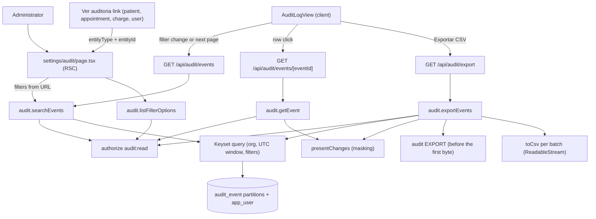

# Technical Specification: F15. Audit Log Viewer

**Complexity:** medium

## 1. Technical Overview

**What.** The read side of the existing `audit` module (simple tier, architecture section 3). F01 already records every event in the append-only, monthly partitioned `audit_event` table through `audit.record()`. F15 adds:
- **Viewer page** at `/settings/audit` ("Configurações > Auditoria"), Administrator only: a filter bar, a result table of 100 events per page with keyset pagination, and a side panel with the event detail and the field-level diff.
- **Filters**: period (at most 366 days), user (including inactive users and "Sistema"), action, entity type, and entity id (together with an entity type).
- **Detail and diff**: before → after per changed field for updates; clinical text is never shown, only "conteúdo clínico alterado" with the character counts already recorded by F07 (`{ changed, beforeLength, afterLength }`).
- **CSV export** of the current filters, up to 100,000 rows, in the F13 CSV format (UTF-8 with BOM, separators of the user's language), streamed in keyset batches. The export records its own `EXPORT` audit event before the first byte.
- **"Ver auditoria" shortcuts** on the patient, appointment, charge and user screens, shown only to Administrators, that open the viewer pre-filtered by that entity.

**Why.** The audit table grows with every mutation, login and sensitive read; the PRD target is p95 ≤ 3 seconds with 1 million rows. That drives the design:
- **Keyset pagination on `(occurred_at, id)`**, never `OFFSET` (architecture section 8, append-only data). Every query is bounded by the organization and the period's UTC window, so partition pruning limits the scan to the months of the period.
- **Two new composite indexes** for the selective filters the existing indexes do not serve (action, entity type alone). User and entity id filters use the F01 indexes `ix_audit_actor` and `ix_audit_entity`.
- **Read-only raw SQL with an explicit `organization_id`**, because `AuditEvent` is not a tenant model in `forTenant` (its `organization_id` is nullable for anonymous login failures, and adding it to the tenant extension would overwrite the writer's explicit organization). This follows the precedent of ADR-037.
- **Presentation rules are pure functions** (diff presentation, masking, cursor encoding, period window) with unit tests; the queries only feed them.

**How it fits the codebase.**
- **Reused as is:**
  - `audit:read` (Administrator only) is already in the permission matrix (`src/shared/authz/permissions.ts`); `authorize()` audits every denial as `PERMISSION_DENIED`.
  - The recorded change shape of `src/shared/audit/diff.ts` (`FieldChange`), the `AuditAction` union of `src/shared/audit/audit-writer.ts`, and the F01 indexes `ix_audit_org_time`, `ix_audit_entity`, `ix_audit_actor`.
  - `src/shared/i18n/csv.ts` (`toCsv`, formula-injection guard) and the streamed CSV pattern of ADR-038 (`analytics/application/export-report.ts`).
  - The client download helper pattern of F13 (`analytics/ui/download.ts`), `zonedTimeToUtc` (ADR-030), `formatDateTime` and `formatLocale`, the organization time zone from `getOrganizationProfile`.
  - Design system components: `Table`, `Sheet`, `Select`, `Input`, `Button`, `Stamp`, `Alert`, `PageHeader`.
- **New in this feature:**
  - `audit` module application layer (four use cases), UI, catalogs, `client.ts` entry (ADR-027).
  - Page `/settings/audit` and three GET Route Handlers under `/api/audit/`.
  - Migration `0017_audit_viewer` with two indexes, mirrored in `schema.prisma`.
  - The "Auditoria" sidebar item and the "Ver auditoria" links on four host screens.
  - ADR-039 and design system section 5.19, in both languages.

### Scope

**Included:**
- Full feature scope (the PRD has no Core/Full split for F15):
  - Administrator-only access to the page, the read endpoints and the export.
  - Filters by period (≤ 366 days), user, action, entity type and entity id.
  - Result table (date/time, user, action, entity, summary), 100 per page, p95 ≤ 3 s with 1 million rows.
  - Detail side panel with the field-level diff; clinical text masked with character counts.
  - CSV export up to 100,000 rows, itself audited.
  - "Ver auditoria" links on the patient, appointment (agenda side panel), charge and user screens.
- Integrated from cross-cutting concerns:
  - authorization (`audit:read` first in every use case, denials audited by `authorize`);
  - tenancy (explicit `organization_id` in every raw query; cross-organization test);
  - audit of the export (architecture 5.3);
  - organization time zone for the period and for displayed instants (ADR-019, ADR-030);
  - three catalogs (pt-BR, en, es) for the screen, labels of actions and entity types, the CSV header and values (ADR-028);
  - design system tables, side panel, stamps and filter bar (sections 5.4, 5.5, 5.7, 5.17, 5.18).

**Deferred:**
- Archiving partitions older than 5 years (architecture 5.3; F01 deferred it until the first partitions reach that age).
- Following related entities (for example the appointments and clinical notes of a patient) when filtering by an entity. The PRD filter is the entity itself (decision D6).
- Exports in PDF (the PRD asks for CSV only).

**Input contracts (Consumes):**
- **F01:** `audit_event` rows (`id`, `occurred_at`, `organization_id`, `actor_type`, `actor_user_id`, `action`, `entity_type`, `entity_id`, `summary`, `changes`, `metadata`, `ip_address`, `request_id`), the `FieldChange` shape, `app_user` (`id`, `name`, `status`) for actor names, and the organization time zone (`getOrganizationProfile`).

**Output contracts (Provides):**
- **URL contract** `/settings/audit?from=YYYY-MM-DD&to=YYYY-MM-DD&user=…&action=…&entityType=…&entityId=…`, used by the "Ver auditoria" links and by any future feature that wants to deep-link into the viewer.
- `auditHref(entityType, entityId)` and `AuditLink` from `@/modules/audit/client`, used by the host screens.

### Traceability to the PRD

| PRD block | Where in this spec |
|---|---|
| Consumes (F01 audit events) | Scope (input contracts), section 6 |
| Capabilities: access | Sections 3 (D1), 4, 5 |
| Capabilities: filters, 366 days | Section 5 (filters), decisions D4, D6 |
| Capabilities: table, 100 per page, p95 ≤ 3 s | Decisions D2, D3; section 6 (indexes) |
| Capabilities: detail and clinical masking | Decision D7; section 5 (detail) |
| Capabilities: CSV export, audited | Decision D8; section 5 (export) |
| Experience: Configurações > Auditoria, side panel | Section 4 (frontend), decision D9 |
| Experience: "Ver auditoria" shortcuts | Section 4 (host screens), decision D10 |

## 2. Architecture Impact

### Affected components

| Component | Path | Change |
|---|---|---|
| Audit module | `src/modules/audit/` | Application layer (4 use cases, queries, presenters), UI, catalogs, `client.ts` |
| Viewer page | `src/app/(app)/settings/audit/page.tsx` | New |
| Read and export endpoints | `src/app/api/audit/events/route.ts`, `src/app/api/audit/events/[eventId]/route.ts`, `src/app/api/audit/export/route.ts` | New Route Handlers |
| Host screens | `src/app/(app)/patients/[patientId]/page.tsx`, `src/app/(app)/financial/charges/[chargeId]/page.tsx`, `src/app/(app)/settings/users/page.tsx`, the scheduling appointment panel | "Ver auditoria" link for Administrators |
| Composition | `src/composition.ts` | Registers `auditCatalog` |
| Sidebar | `src/shared/ui/app-shell/navigation.ts` and the shell catalogs | "Auditoria" item in "Configurações" |
| Database | `prisma/migrations/0017_audit_viewer/migration.sql`, `prisma/schema.prisma` | Two indexes on `audit_event` |
| Architecture docs | `docs/architecture.en.md`, `docs/architecture.pt-BR.md` | ADR-039; F15 row in section 8 updated |
| Design system docs | `docs/design-system.en.md`, `docs/design-system.pt-BR.md` | Section 5.19 Audit log |

### Data flow



- The `audit` module reads `audit_event` and the user names in `app_user` with read-only SQL (architecture section 3: `audit` reads across modules through dedicated read queries). The only write is the `EXPORT` event.
- The host screens import only `@/modules/audit/client` (client-safe) or `@/modules/audit` (server pages).

## 3. Technical Decisions

Batch mode: every decision below is the spec-writer recommendation, auto-accepted, and may be reviewed (see Assumptions).

| Decision | Chosen Approach | Alternative Considered | Trade-off |
|---|---|---|---|
| D1. Access | `audit:read` (Administrator) checked first in every use case; the page uses `requirePermission("audit:read")`; the sidebar item and the "Ver auditoria" links are rendered only when `can(ctx, "audit:read")` | A separate `audit:export` permission | One permission covers view and export, as the PRD matrix has one "Audit log" row |
| D2. Pagination | Keyset on `(occurred_at DESC, id DESC)`, 100 rows (`AUDIT_PAGE_SIZE`). The cursor is an opaque base64url of `occurredAt|id`. The response carries `nextCursor`; the client keeps a stack of previous cursors for "Página anterior" and shows "Página N". No page numbers beyond that | Offset pagination with a total | Deep pages stay as fast as the first one. The user cannot jump to page 50, which an investigation does not need |
| D3. Result count | A capped count: `count(*)` over the filtered rows with `LIMIT 100001`. The screen shows "{count} eventos" or "Mais de 100.000 eventos" and uses it to disable "Exportar CSV" with the advice | An exact count | Bounded work per search; the export limit is known before clicking |
| D4. Period | `from` and `to` are dates in the organization's time zone (audit events have no unit). The UTC window is `[zonedTimeToUtc(from 00:00), zonedTimeToUtc(to + 1 day 00:00))`. Span ≤ 366 days (`AUDIT_MAX_PERIOD_DAYS`). Default: the last 30 days including today. Links from "Ver auditoria" use the last 366 days | The F12 period presets | The presets live in `analytics`; importing them would couple `audit` to `analytics` for little gain |
| D5. Read endpoints | GET Route Handlers return JSON for search and detail; the page renders the first page on the server. The client uses `fetch` with `AbortController`, so a filter change cancels the request in flight | Server Actions, as F13 | GET reads run in parallel and can be cancelled (as ADR-025 argues); the filters are the URL. Mutations remain absent (the viewer never writes except the export event) |
| D6. Entity filter | The entity id filter requires an entity type (validation error otherwise) and matches `entity_type = $type AND entity_id = $id` exactly. The id field is enabled only after a type is chosen | Entity id alone; following related entities | Uses `ix_audit_entity`; related records (a patient's appointments) are not followed |
| D7. Diff presentation | A pure `presentChanges(entityType, changes)` turns each `FieldChange` into one of: `value` (before → after), `sensitive` (`{ changed, beforeLength, afterLength }` → "conteúdo clínico alterado ({before} → {after} caracteres)"), or `hidden` (keys matching a secret denylist: password, pin, token, secret, hash → "valor oculto"). Field labels come from `audit.fields.<key>` when the catalog has the key, otherwise the raw key in `mono`. Values: `null` → "—", booleans → "Sim"/"Não", ISO instants → date and time in the organization zone, other values → their JSON text | Rendering the raw JSON | Defense in depth: even a future writer that forgets to mark a secret never displays it. Clinical masking relies on the F01/F07 recording shape, which never stores the text |
| D8. CSV export | `GET /api/audit/export` with the same filters. The capped count runs first: above 100,000 rows the request fails with `AUDIT_EXPORT_TOO_LARGE` before any byte. Then the `EXPORT` event (`entityType: "audit_log"`, metadata: format, rows, filters) is committed, then the CSV streams in keyset batches of 2,000 (`AUDIT_EXPORT_BATCH_SIZE`) with `toCsv`. Columns: Data, Hora, Usuário, Ação, Tipo de entidade, Id da entidade, Resumo, Alterações, Endereço IP, Id do evento. "Alterações" is one cell: `field: before → after` entries joined by " \| ", with the same masking as the panel | A pg-boss job and a stored file | Same mechanism and trade-offs as ADR-038 (rows recorded during a long export may appear; the export event itself is recorded before the scan and may appear in the file) |
| D9. Viewer layout | Filter bar on top (design system 5.17/5.18 pattern): De, Até, Usuário, Ação, Tipo de entidade, Id da entidade, then "Limpar filtros" (ghost). Filters apply on change (debounced 300 ms for the id field); no primary "Buscar" button. "Exportar CSV" is the single primary button of the screen. Clicking a row (or Enter on it) opens a 560 px side panel with the detail; the row gets the selected style | A "Buscar" primary button | Same interaction as the dashboard filters; the export is the one action that produces something |
| D10. "Ver auditoria" links | `AuditLink` (ghost/outline button, history icon) in the header actions of the patient page and of the charge page, a ghost row action on the users table, and a ghost link in the appointment side panel. Each passes its own entity type (`patient`, `charge`, `user`, `appointment`) and id, and opens `/settings/audit` in the same tab | Opening a new tab | The link is visible only to Administrators; other roles never see it |
| D11. Not audited reads | Searching and opening a detail are not audited; only the export is (PRD F15). Denials are audited by `authorize` as everywhere | Auditing every search | Avoids the viewer filling its own log; the audit log contains no clinical text to protect, and Administrators already have full access to administrative data |
| D12. Indexes | Migration `0017_audit_viewer` adds `ix_audit_org_action_time (organization_id, action, occurred_at DESC)` and `ix_audit_org_entity_type_time (organization_id, entity_type, occurred_at DESC)` on the partitioned parent (inherited by every partition), mirrored as `@@index` in `schema.prisma` so `prisma migrate diff` stays clean | No new index | Rare actions (permission denied) and broad entity types otherwise scan the whole period; two more index writes per event are cheap at this volume |
| D13. Tenancy | Raw SQL with `organization_id = $ctx.organizationId` on every query; `AuditEvent` stays out of `TENANT_MODELS`. Events without an organization (unknown-email login failures, F01 decision) are never shown | Adding `AuditEvent` to the tenant extension | The extension would overwrite the writer's explicit `organizationId` (null for anonymous flows). An integration test with two organizations guards the filter |

### Assumptions

Each item is a default applied where the PRD is silent (Batch Mode Auto-Accept Policy, row "Technical decisions with a clear recommendation" unless noted). The user can review and override them.

1. **Scope**: the PRD has no Core/Full split for F15, so the full scope is specified (policy row "Scope").
2. **Surfaces**: the contract emits HTTP API, UI and E2E surfaces, because the PRD has signals for all three (export, screen, cross-screen link) (policy row "Contract surface set ambiguous").
3. **Quality gates** auto-included from `package.json` and `.github/workflows/ci.yml`: `npm run lint`, `npm run typecheck`, `npm run format:check`, `npm test`, `npm run test:integration`, `npm run test:e2e` (policy row "Quality gates — detected gates"). There is no wrapper script that runs them all.
4. **Action labels** (pt-BR from the PRD action list): Criação (`CREATE`), Atualização (`UPDATE`), Exclusão (`DELETE`), Leitura de dado sensível (`READ_SENSITIVE`), Login (`LOGIN`), Falha de login (`LOGIN_FAILED`), Permissão negada (`PERMISSION_DENIED`), Exportação (`EXPORT`). The actions F01 also records but the PRD does not list are offered too: Logout (`LOGOUT`), Redefinição de senha solicitada (`PASSWORD_RESET_REQUESTED`), Senha redefinida (`PASSWORD_RESET`). `READ_SENSITIVE` is recorded for clinical note, sensitive document and consent reads (F05, F07, F08); the PRD label "leitura de dado sensível" covers all three, and the entity column tells them apart.
5. **Entity types**: the filter lists the entity types recorded by the implemented modules (`AUDIT_ENTITY_TYPES` constant in `audit/application/entity-types.ts`), grouped as: Pacientes (patient, consent_record, privacy_terms_version), Agenda (appointment, appointment_series, cancellation_reason), Registros clínicos (clinical_note, clinical_note_version, clinical_note_addendum, clinical_attachment, clinical_alert), Documentos (patient_document, document_template, document_category, document_storage_usage), Financeiro (charge, payment, payment_method, patient_package, package_template, package_settings, cash_register, cash_movement, financial_entry, financial_entry_series, financial_category, financial_attachment), Cadastros (unit, unit_closure, room, service, service_category, professional, professional_schedule, professional_time_off), Acesso e configurações (user, invitation, organization, report, audit_log). The PRD "configurações" maps to `organization`. A type found in a row but missing from the constant is shown by its raw key.
6. **User filter**: "Todos", "Sistema" (`actor_type = 'SYSTEM'`) and every user of the organization, active and inactive, sorted by name, inactive ones marked "(inativo)". Anonymous events with an organization (login failure of a known email) show "Anônimo" in the user column and are matched by "Todos" only.
7. **Summary column**: the `summary` recorded by the module, as written. When it is empty, the catalog composes "{ação} · {tipo de entidade}".
8. **Personal data in the diff**: before/after values of administrative records (for example a patient's name or phone) are shown unmasked, because Administrators have full access to them (PRD F01 matrix). Clinical text is never present in the log (architecture 5.3). The IP address is shown in the detail and in the CSV.
9. **Entity column**: the entity type label and, in `meta`, the first 8 characters of the id; the full id is in the detail panel with a "Filtrar por esta entidade" ghost link. Entity names are not resolved (no joins into other modules per type).
10. **Time display**: instants are shown in the organization's time zone and the user's language format (`formatDateTime`), with seconds in the detail panel.
11. **CSV file name**: `auditoria-<from>-<to>.csv`, with the slug from the catalog (`audit-log` in en, `auditoria` in es and pt-BR), without personal data.
12. **Patient page link and the dependency graph**: PRD Section 8 lists F01, F05, F06 and F09 as dependencies of F15 (resolved with the product owner: the "Ver auditoria" links live on the patient, appointment and charge screens). F15 mounts the links there; the contract item for the patient link runs on the real patient page.
13. **Cross-feature criterion** "Audit events recorded by F01 are searchable in the audit log viewer (F15) with before/after values" is verified in this feature, because F01's spec delegates the consumer side to F15.
14. **Test data conventions** follow the project: integration fixtures write directly to the database (`tests/integration/helpers.ts`, per-module `support.ts`); E2E journeys run in alphabetical order on one database and reuse the clinic built by the earlier journeys (`tests/e2e/global-setup.ts`, `support.ts` with `sql()`); there are no static fixture files for this feature; the integration environment comes from Testcontainers (`tests/integration/global-setup.ts`), the E2E environment from `tests/e2e/env.ts`.
15. **Load test partitions**: the 1-million-row test creates the monthly partitions of the past 12 months as the owner role before seeding, so the plan matches production (where past months always have their partition) instead of the default partition.

## 4. Component Overview

### Frontend

| File Path | New/Modified | Purpose | Key Responsibilities |
|---|---|---|---|
| `src/app/(app)/settings/audit/page.tsx` | New | Viewer page | `requirePermission("audit:read")`, parses the URL filters, loads the filter options and the first page (invalid filters show the error alert with defaults applied), renders `AuditLogView` |
| `src/modules/audit/ui/audit-log-view.tsx` | New | Client view | Holds filters synced to the URL (`router.replace`), fetches pages with abort, cursor stack, selected row, empty and error states, count line |
| `src/modules/audit/ui/audit-filters.tsx` | New | Filter bar | De, Até, Usuário, Ação, Tipo de entidade (grouped select), Id da entidade (enabled after a type), "Limpar filtros"; labelled, keyboard accessible, inline field errors |
| `src/modules/audit/ui/audit-table.tsx` | New | Result table | Columns Data e hora, Usuário, Ação (stamp), Entidade, Resumo; rows focusable, Enter and click open the panel; pagination "Página anterior" / "Próxima página" and "Página N" |
| `src/modules/audit/ui/audit-detail-panel.tsx` | New | Side panel | Fetches the detail, shows the header (action stamp, date with seconds, user, IP, request id), the entity with "Filtrar por esta entidade", the diff table (Campo, Antes, Depois) or the masked line, and the metadata list |
| `src/modules/audit/ui/audit-export-button.tsx` | New | Export | Primary "Exportar CSV", progress text (`aria-live`), disabled with the advice above 100,000 rows, download through an object URL, error alert |
| `src/modules/audit/ui/audit-link.tsx` | New | Shortcut | `AuditLink({ entityType, entityId, variant })` with the "Ver auditoria" label and history icon |
| `src/modules/audit/client.ts` | New | Client entry (ADR-027) | Re-exports `AuditLink`, `auditHref`, `AuditLogView` and types only |
| `src/shared/ui/app-shell/navigation.ts` | Modified | Sidebar | "Auditoria" in "Configurações", after "Usuários", `anyOf: ["audit:read"]`, icon `history` |
| `src/app/(app)/patients/[patientId]/page.tsx` | Modified | Host | `AuditLink` (outline) in the header actions when `can(ctx, "audit:read")` |
| `src/app/(app)/financial/charges/[chargeId]/page.tsx` | Modified | Host | Same, entity `charge` |
| `src/app/(app)/settings/users/page.tsx` and the users table | Modified | Host | Ghost row action "Ver auditoria", entity `user` |
| Scheduling appointment side panel (`src/modules/scheduling/ui/…`) and `src/app/(app)/schedule/page.tsx` | Modified | Host | The page passes `canViewAudit`; the panel renders `AuditLink` from `@/modules/audit/client`, entity `appointment` |

### Backend

| File Path | New/Modified | Purpose | Key Responsibilities |
|---|---|---|---|
| `src/modules/audit/index.ts` | Modified | Public API | `audit` (bound use cases), `createAudit(adjust?)` for tests, `auditCatalog`, types; keeps `ensureAuditPartitions` |
| `src/modules/audit/application/limits.ts` | New | Named constants | `AUDIT_PAGE_SIZE = 100`, `AUDIT_MAX_PERIOD_DAYS = 366`, `AUDIT_CSV_MAX_ROWS = 100_000`, `AUDIT_EXPORT_BATCH_SIZE = 2_000`, `AUDIT_DEFAULT_PERIOD_DAYS = 30`, each with its PRD reference |
| `src/modules/audit/application/entity-types.ts` | New | Registry | `AUDIT_ACTIONS`, `AUDIT_ENTITY_TYPES` with their groups |
| `src/modules/audit/application/schemas.ts` | New | Zod input | Filters (dates, `user`, `action`, `entityType`, `entityId` uuid, `cursor`); messages are `audit.validation.*` keys |
| `src/modules/audit/application/period.ts` | New | Pure | `resolveAuditPeriod(input, today, timeZone)` → dates and UTC window; span and order checks |
| `src/modules/audit/application/cursor.ts` | New | Pure | `encodeCursor`, `decodeCursor` (invalid → validation error) |
| `src/modules/audit/application/present-changes.ts` | New | Pure | `presentChanges`, `changesText` (CSV cell), secret denylist |
| `src/modules/audit/application/errors.ts` | New | Errors | `AuditErrors`: `periodTooLong`, `periodInvalid`, `entityTypeRequired`, `eventNotFound`, `exportTooLarge(count)` |
| `src/modules/audit/application/queries.ts` | New | Read SQL | `pageQuery`, `cappedCount`, `batchQuery`, `eventById`, `actorOptions`; explicit `organization_id`, UTC window, `LEFT JOIN app_user` |
| `src/modules/audit/application/search-events.ts` | New | Use case `SearchAuditEvents` | Authorize → parse → period (org zone) → page + capped count → `AuditPage` |
| `src/modules/audit/application/get-event.ts` | New | Use case `GetAuditEvent` | Authorize → load by id within the organization → present changes and metadata |
| `src/modules/audit/application/export-events.ts` | New | Use case `ExportAuditEvents` | Authorize → parse → capped count vs. limit → record `EXPORT` → stream of CSV batches |
| `src/modules/audit/application/list-filter-options.ts` | New | Use case `ListAuditFilterOptions` | Authorize → users (active and inactive), actions, entity types |
| `src/modules/audit/messages/{pt-BR,en,es}.json`, `messages/catalog.ts` | New | Catalogs | `audit.*`: title, filters, columns, actions, entity types, fields, values, panel, export, empty state, errors, CSV header and file slug |
| `src/app/api/audit/events/route.ts` | New | Route Handler | GET search → JSON or `{ code, message }` with the error status (401 without session) |
| `src/app/api/audit/events/[eventId]/route.ts` | New | Route Handler | GET detail → JSON |
| `src/app/api/audit/export/route.ts` | New | Route Handler | GET export → streamed CSV, as `/api/reports/[report]/export` |
| `src/composition.ts` | Modified | Wiring | `registerCatalog("audit", auditCatalog)` |
| `src/shared/i18n/messages/{pt-BR,en,es}.json` | Modified | Shell catalog | `shell.navigation.audit` |

### Database

| Migration File | Tables Affected | Operation | Notes |
|---|---|---|---|
| `prisma/migrations/0017_audit_viewer/migration.sql` | `audit_event` (parent and partitions) | CREATE INDEX ×2 | Hand-written; not `CONCURRENTLY` (not supported on a partitioned parent); mirrored in `schema.prisma` |

## 5. API Contracts

### Error codes

| Code | HTTP | pt-BR message (catalog `audit`) |
|---|---|---|
| `AUDIT_PERIOD_TOO_LONG` | 400 | O período deve ter no máximo 366 dias. |
| `AUDIT_PERIOD_INVALID` | 400 | A data final deve ser igual ou posterior à data inicial. |
| `AUDIT_ENTITY_TYPE_REQUIRED` | 400 | Escolha o tipo de entidade para filtrar por id. |
| `AUDIT_EVENT_NOT_FOUND` | 404 | Evento de auditoria não encontrado. |
| `AUDIT_EXPORT_TOO_LARGE` | 422 | O resultado tem {count} eventos. A exportação em CSV aceita até 100.000 linhas. Reduza o período ou aplique mais filtros. |
| `VALIDATION_FAILED` (shared) | 400 | Field messages from `audit.validation.*` (invalid date, invalid id, unknown action or entity type, invalid cursor) |
| `AUTH_UNAUTHENTICATED` (shared) | 401 | Route Handlers without a session |
| `AUTHZ_FORBIDDEN` (shared) | 403 | Shared forbidden message; the page renders `forbidden()` |

For `AUDIT_EXPORT_TOO_LARGE`, `count` is the capped count: the message reads "mais de 100.000" when the cap is reached (`audit.errors.AUDIT_EXPORT_TOO_LARGE_CAPPED`).

### Filters (query string, shared by the three endpoints and the page URL)

| Field | Type | Required | Validation | Description |
|---|---|---|---|---|
| `from`, `to` | `YYYY-MM-DD` | no (default last 30 days) | `to ≥ from`; span ≤ 366 days | Inclusive dates in the organization's time zone |
| `user` | `"ALL"`, `"SYSTEM"` or uuid | no (default `ALL`) | uuid must be a user of the organization | Actor filter |
| `action` | `"ALL"` or an `AuditAction` | no (default `ALL`) | one of `AUDIT_ACTIONS` | Action filter |
| `entityType` | `"ALL"` or a type key | no (default `ALL`) | `[a-z_]{1,40}` | Entity type filter |
| `entityId` | uuid | no | requires `entityType ≠ ALL` | Exact entity |
| `cursor` | string | no | decodes to `occurredAt|id` | Keyset position (search only) |

### Endpoint: Search events

- **Method:** GET
- **Path:** `/api/audit/events`
- **Authentication:** session cookie; `audit:read`. No session: 401. Manager, Front Desk, Professional: 403, denial audited.

```
GET /api/audit/events?from=2026-09-19&to=2026-10-18&user=ALL&action=UPDATE&entityType=patient&entityId=0192a1c4-7b3e-7c11-9f00-3a1b2c3d4e5f
```

**Response (200):**

| Field | Type | Description |
|---|---|---|
| `period` | `{ from, to }` | Resolved dates |
| `items[]` | object | Up to 100 events, newest first |
| `items[].id` | uuid | Event id |
| `items[].occurredAt` | ISO instant | Event time (UTC) |
| `items[].actor` | `{ type: "USER" \| "SYSTEM" \| "ANONYMOUS", userId, name, active }` | `name` is null for system and anonymous |
| `items[].action` | `AuditAction` | Raw code; labels come from the catalog |
| `items[].entityType`, `items[].entityId` | string, uuid | Nullable |
| `items[].summary` | string | Recorded summary or the composed fallback |
| `items[].hasChanges` | boolean | Whether the detail has a diff |
| `nextCursor` | string \| null | Null on the last page |
| `matched` | `{ count, capped }` | Capped count (≤ 100,001); `capped` true when the cap was reached |
| `pageSize` | 100 | |
| `exportLimit` | 100000 | Lets the client disable the export |
| `timeZone` | IANA zone | Organization zone for display |

```json
{
  "period": { "from": "2026-09-19", "to": "2026-10-18" },
  "items": [
    {
      "id": "0192f0a8-1d2e-7a00-8c11-5b6c7d8e9f01",
      "occurredAt": "2026-10-17T13:42:05.120Z",
      "actor": { "type": "USER", "userId": "0192a0b1-0000-7000-8000-000000000001", "name": "Ana Admin", "active": true },
      "action": "UPDATE",
      "entityType": "patient",
      "entityId": "0192a1c4-7b3e-7c11-9f00-3a1b2c3d4e5f",
      "summary": "Paciente atualizado",
      "hasChanges": true
    }
  ],
  "nextCursor": "MjAyNi0xMC0xN1QxMzo0MjowNS4xMjBafDAxOTJmMGE4",
  "matched": { "count": 37, "capped": false },
  "pageSize": 100,
  "exportLimit": 100000,
  "timeZone": "America/Sao_Paulo"
}
```

### Endpoint: Event detail

- **Method:** GET
- **Path:** `/api/audit/events/[eventId]`
- **Authentication:** as above. An id of another organization returns 404 `AUDIT_EVENT_NOT_FOUND`.

**Response (200):**

| Field | Type | Description |
|---|---|---|
| `id`, `occurredAt`, `actor`, `action`, `entityType`, `entityId`, `summary` | as in search | |
| `ipAddress` | string \| null | |
| `requestId` | string \| null | |
| `changes[]` | `{ field, label, kind: "value" \| "sensitive" \| "hidden", before, after, beforeLength, afterLength }` | Display-ready; `before`/`after` are formatted strings for `value`, null otherwise |
| `metadata[]` | `{ key, value }` | Flattened metadata (for example `permission`, `target`, `format`, `rows`) as display strings |

```json
{
  "id": "0192f0a9-2222-7a00-8c11-5b6c7d8e9f02",
  "occurredAt": "2026-10-17T14:02:11.004Z",
  "actor": { "type": "USER", "userId": "0192a0b1-0000-7000-8000-000000000004", "name": "Dra. Paula", "active": true },
  "action": "UPDATE",
  "entityType": "clinical_note",
  "entityId": "0192a3d5-0000-7000-8000-00000000aa01",
  "summary": "Registro clínico editado",
  "ipAddress": "203.0.113.20",
  "requestId": "0192f0a9-2222-7a00-8c11-000000000abc",
  "changes": [
    { "field": "content", "label": "Conteúdo", "kind": "sensitive", "before": null, "after": null, "beforeLength": 120, "afterLength": 154 }
  ],
  "metadata": []
}
```

The panel renders the sensitive change as "conteúdo clínico alterado (120 → 154 caracteres)".

### Endpoint: Export CSV

- **Method:** GET
- **Path:** `/api/audit/export`
- **Authentication:** as above.
- **Query:** the filters (`cursor` ignored).

**Response (200):**

| Header | Value |
|---|---|
| `Content-Type` | `text/csv; charset=utf-8` |
| `Content-Disposition` | `attachment; filename="auditoria-2026-09-19-2026-10-18.csv"` |
| `X-Report-Rows` | Row count |
| `Cache-Control` | `private, no-store` |

Body (pt-BR):

```
Data;Hora;Usuário;Ação;Tipo de entidade;Id da entidade;Resumo;Alterações;Endereço IP;Id do evento
17/10/2026;10:42:05;Ana Admin;Atualização;Paciente;0192a1c4-7b3e-7c11-9f00-3a1b2c3d4e5f;Paciente atualizado;fullName: Maria Souza → Maria Souza Lima | phoneMobile: +5511988881111 → +5511977772222;203.0.113.10;0192f0a8-1d2e-7a00-8c11-5b6c7d8e9f01
17/10/2026;11:02:11;Dra. Paula;Atualização;Nota clínica;0192a3d5-0000-7000-8000-00000000aa01;Registro clínico editado;content: conteúdo clínico alterado (120 → 154 caracteres);203.0.113.20;0192f0a9-2222-7a00-8c11-5b6c7d8e9f02
```

**Response (error):** `{ "code": "AUDIT_EXPORT_TOO_LARGE", "message": "O resultado tem mais de 100.000 eventos…" }` with status 422.

**Audit event (every successful export):**

```json
{
  "action": "EXPORT",
  "entityType": "audit_log",
  "summary": "Exportação do log de auditoria (CSV)",
  "metadata": {
    "format": "csv",
    "rows": 37,
    "filters": { "from": "2026-09-19", "to": "2026-10-18", "user": "ALL", "action": "UPDATE", "entityType": "patient", "entityId": "0192a1c4-7b3e-7c11-9f00-3a1b2c3d4e5f" }
  }
}
```

### Public module API (Provides)

- `audit.searchEvents(ctx, input: unknown): Promise<Result<AuditPage>>`
- `audit.getEvent(ctx, eventId: string): Promise<Result<AuditEventDetail>>`
- `audit.exportEvents(ctx, input: unknown): Promise<Result<{ fileName; contentType; rowCount; body: ReadableStream<Uint8Array> }>>`
- `audit.listFilterOptions(ctx): Promise<Result<AuditFilterOptions>>`
- `createAudit(adjust?)` with a replaceable clock for tests; `auditCatalog`; `AUDIT_ACTIONS`, `AUDIT_ENTITY_TYPES`.
- `@/modules/audit/client`: `AuditLink`, `auditHref(entityType, entityId)` → `/settings/audit?from=<today−365>&to=<today>&entityType=…&entityId=…` (dates resolved on the server page when absent, so the client helper may omit them).

## 6. Data Model

No new table. `audit_event` (F01, migration 0002) is read; `app_user` is joined for names.

### New indexes

| Index Name | Columns | Type | Purpose |
|---|---|---|---|
| `ix_audit_org_action_time` | `organization_id, action, occurred_at DESC` | btree (partitioned) | Action filter, including rare actions over long periods |
| `ix_audit_org_entity_type_time` | `organization_id, entity_type, occurred_at DESC` | btree (partitioned) | Entity type filter without an id |

### Existing indexes used

| Filter combination | Index |
|---|---|
| Period only, user `SYSTEM` | `ix_audit_org_time` |
| User (uuid) | `ix_audit_actor` (`actor_user_id, occurred_at DESC`), plus the organization predicate |
| Entity type + id | `ix_audit_entity` (`entity_type, entity_id, occurred_at DESC`), plus the organization predicate |
| Action | `ix_audit_org_action_time` (new) |
| Entity type | `ix_audit_org_entity_type_time` (new) |

### Migration

```sql
-- 0017_audit_viewer: indexes for the F15 viewer filters (spec docs/F15-audit-log-viewer, section 6).
-- Created on the partitioned parent, so every existing and future partition gets them.
CREATE INDEX "ix_audit_org_action_time" ON "audit_event"("organization_id", "action", "occurred_at" DESC);
CREATE INDEX "ix_audit_org_entity_type_time" ON "audit_event"("organization_id", "entity_type", "occurred_at" DESC);
```

`schema.prisma` gains the two matching `@@index` lines on `AuditEvent` (with `map:`), so the CI drift check passes.

### Query shape (illustrative)

- **Page:** `SELECT e.*, u.name, u.status FROM audit_event e LEFT JOIN app_user u ON u.id = e.actor_user_id WHERE e.organization_id = $org AND e.occurred_at >= $start AND e.occurred_at < $end [AND filters] [AND (e.occurred_at, e.id) < ($cursorAt, $cursorId)] ORDER BY e.occurred_at DESC, e.id DESC LIMIT 101` (the 101st row only tells whether a next page exists).
- **Capped count:** `SELECT count(*) FROM (SELECT 1 FROM audit_event WHERE … LIMIT 100001) s`.
- **Batches:** the page query with `LIMIT 2000` and the previous batch's last key.
- **Detail:** `WHERE organization_id = $org AND id = $id` (the primary key `(id, occurred_at)` is searched per partition).
- `EXPLAIN ANALYZE` of the page query for each filter combination, on the 1-million-row dataset, is attached to the pull request (architecture section 8).

## 7. Testing Strategy

### Test files

| File | Kind |
|---|---|
| `src/modules/audit/application/present-changes.test.ts` | Vitest unit |
| `src/modules/audit/application/period.test.ts` | Vitest unit |
| `src/modules/audit/application/cursor.test.ts` | Vitest unit |
| `src/modules/audit/messages/catalog.test.ts` (or the existing catalog parity test) | Vitest unit: keys and placeholders equal in the three languages |
| `tests/integration/audit/support.ts` | Fixtures: two organizations, users of the four roles plus an inactive user, a known event set (updates with changes, clinical update with lengths, sensitive read, login failure, denial, export, system event, an event older than 366 days), helpers to seed N events with `generate_series` and to create past monthly partitions as the owner |
| `tests/integration/audit/search.test.ts` | Integration (Testcontainers) |
| `tests/integration/audit/detail.test.ts` | Integration |
| `tests/integration/audit/export.test.ts` | Integration: use case and Route Handler |
| `tests/integration/audit/performance.test.ts` | Integration with 1,000,000 seeded events |
| `tests/e2e/f15-audit-log-viewer.spec.ts` | Playwright |

### Unit tests

- `F15: an update change renders as before and after values`.
- `F15: a sensitive change renders only as clinical content changed with character counts`.
- `F15: secret-like fields are hidden even when recorded with values`.
- `F15: null, boolean and instant values are formatted for display`.
- `F15: the CSV changes cell joins the fields and keeps the masking`.
- `F15: the period window uses the organization's time zone and includes the end date`.
- `F15: a period of 367 days or ending before it starts is rejected`.
- `F15: a cursor round-trips and an invalid cursor is rejected`.

### Integration tests

- **Authorization:** `F15: only Administrator can search, open details, list filter options and export`; `F15: denied audit access is itself audited as permission denied`; `F15: the audit page renders 403 for other roles`.
- **Filters:** `F15: period filter returns only events inside the local dates`; `F15: user filter returns events of that user, including an inactive user`; `F15: SYSTEM user filter returns system events`; `F15: action filter returns only that action`; `F15: entity type filter returns only that type`; `F15: entity type and id filter returns only that entity`; `F15: entity id without a type is rejected`; `F15: combined filters intersect`.
- **Pagination:** `F15: pages hold 100 events newest first and the cursor returns every event exactly once`; `F15: the capped count reports more than 100,000`.
- **Detail:** `F15: update events show field-level before and after values`; `F15: clinical note changes show only clinical content changed with character counts`; `F15: metadata of denials and exports is listed`; `F15: an event of another organization is not found`.
- **F01 consumer:** `F15: events recorded by F01 use cases are searchable with their before and after values` (updates the organization settings and a user role through `identity`, then searches and opens the details).
- **Tenancy:** `F15: events of another organization and events without an organization never appear`.
- **Export:** `F15: CSV export follows the F13 format in pt-BR and en`; `F15: CSV export of 100,000 rows streams every row`; `F15: CSV export above 100,000 rows is refused before streaming`; `F15: every export is recorded as an EXPORT audit event with filters and row count`; `F15: the export endpoint returns 401 without a session and 403 for Manager`.
- **Performance:** `F15: each filter combination answers within 3 seconds at p95 with 1 million events` (20 runs per combination: period only, user, action, entity type, entity type + id, combined; first and a deep page).

### E2E journeys

1. `F15: administrator filters the audit log, opens an update diff and exports CSV` (checks the side panel, the download name and BOM, and the new EXPORT row in the log).
2. `F15: "Ver auditoria" on a patient page opens the viewer filtered by that patient`.
3. `F15: front desk does not see Auditoria and gets the 403 page at /settings/audit`.
